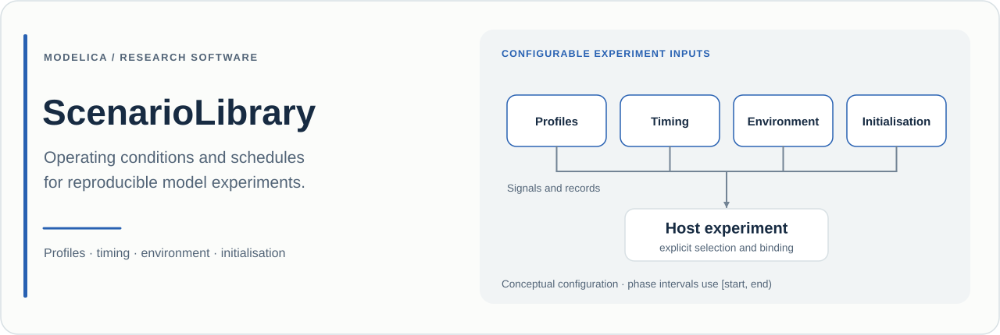

# ScenarioLibrary

**Reusable, deterministic experiment conditions for Modelica simulations.**

**English** · [简体中文](README_zh.md)

<!-- learning-guide:start -->
> **[Detailed bilingual learning and usage guide](docs/LearningGuide.html)** — Chinese and British English in one offline-readable HTML file, with a complete component reference and every example explained. Download the HTML and open it in a browser to use language switching and search.
<!-- learning-guide:end -->

[](package.mo)
[](package.mo)

[Purpose](#purpose) · [Model organisation](#model-organisation) · [Quick start](#quick-start) · [Examples](#examples) · [Research use](#research-use)

## Purpose

A simulation is defined by its operating conditions as well as its physical model. ScenarioLibrary makes those conditions explicit: initial states, commanded trajectories, environmental inputs, operating modes and the timing of a mission. These elements can be inspected, connected and reused as Modelica components instead of being scattered across a host model.

The library is intended for researchers comparing designs, controllers or operating assumptions under a common experiment definition. A single planned input can drive several independently parameterised models; phase and event definitions can identify the intervals in which their behaviour should be compared. The implementation uses records, functions, signal blocks and selected physical boundary models.

| At a glance | Current source |
| :--- | :--- |
| Modelica package | `ScenarioLibrary` |
| Package version | **0.3.0**, declared in [package.mo](package.mo) |
| Declared library dependency | Modelica Standard Library **4.0.0** |
| Example models | **8**, in [Examples](Examples) |
| Reviewed source baseline | [`ce9e96f`](https://github.com/Ruizhe-Yang/ScenarioLibrary/commit/ce9e96f4ce0cafb082a1cc59af72ccdaccb389c0), 12 November 2026 |

## How it works

**Initial conditions are explicit bindings.** Records such as [`Initialization.TranslationalState`](Initialization/TranslationalState.mo) carry independent start values and `fixed` choices. The host model binds these fields to the relevant state variables. Merely declaring a record does not initialise a component: the examples show the corresponding parameter modifications.

**Planned profiles have defined time semantics.** The profile collection includes steps, ramps, piecewise constant and linear trajectories, pulses and finite repeated profiles. The standard profile blocks can expose an optional `enable` input; when enabled, each rising edge establishes a local time origin. Otherwise they use absolute simulation time. Endpoint holds and interpolation rules belong to the selected profile.

**Mission phases and observation windows are separate components.** [`Timing.PhaseSchedule`](Timing/PhaseSchedule.mo) assigns phases using strictly increasing boundaries and returns a phase index, identifier, local time and completion flag. Phases and [`Timing.TimeWindow`](Timing/TimeWindow.mo) use half-open intervals, `[start, end)`. At mission completion, the phase index returns to zero. [`Timing.LocalClock`](Timing/LocalClock.mo) provides an explicit time reference, including optional repeated triggering; [`Timing.DwellTrigger`](Timing/DwellTrigger.mo) counts one qualifying occurrence per continuously true dwell.

**Environmental conditions remain inspectable assumptions.** For example, [`Environment.Atmosphere`](Environment/Atmosphere.mo) implements a dry-air tropospheric relation over **0–11,000 m** and asserts that range. Temperature, pressure, wind and inclination components provide separate planned quantities. Their units and coordinate conventions should be matched to the receiving model.

## Model organisation

| Package | Role | Representative starting point |
| :--- | :--- | :--- |
| [Initialization](Initialization) | Mechanical, electrical, thermal, fluid and signal initial-state records | `TranslationalState`, `ElectricalState` |
| [Profiles](Profiles) | Planned scalar trajectories and repeated operating profiles | `Ramp`, `PiecewiseLinear`, `Pulse` |
| [Environment](Environment) | Environmental signals and physical boundary conditions | `Atmosphere`, `Inclination`, `FluidReservoir` |
| [Operating](Operating) | Load, command and mode schedules | `LoadDemand`, `CommandSchedule`, `ModeSchedule` |
| [Timing](Timing) | Phases, windows, clocks, dwell and event sequences | `PhaseSchedule`, `TimeWindow`, `EventSequence` |
| [Utilities](Utilities) | Table functions, types and example views | `Functions.TableIndex` |
| [Examples](Examples) | Connected demonstrations of the principal workflows | `MultiphaseMission` |
| [UsersGuide](UsersGuide) | In-tool information pages | `Overview` |

The [model catalogue](model-catalog.csv) provides a broader class inventory. Use the actual class declarations and examples when selecting parameter names and connectors.

## Quick start

Clone the repository into a directory named after the Modelica package:

```bash
git clone https://github.com/Ruizhe-Yang/ScenarioLibrary.git
cd ScenarioLibrary
```

In a Modelica environment, load **Modelica 4.0.0**, open the root `package.mo`, then select `ScenarioLibrary.Examples.MultiphaseMission`. Its experiment annotation specifies a **0–10 s** interval, **0.01 s** output interval and **1e-6** tolerance.

An equivalent OpenModelica scripting entry point, executed from the repository directory, is:

```modelica
loadModel(Modelica, {"4.0.0"});
loadFile("package.mo");
getErrorString();
simulate(ScenarioLibrary.Examples.MultiphaseMission,
  startTime=0, stopTime=10, numberOfIntervals=1000, tolerance=1e-6);
getErrorString();
```

Inspect `schedule.phaseIndex`, `schedule.localTime`, `demand` and `finished`. The source defines phase boundaries `{0, 1, 3, 7, 10}`; these determine the expected transitions. Next, open `ReusableScenario` to see one ramp applied to two first-order hosts with time constants **0.2 s** and **0.5 s**. These are code-defined example settings, not performance measurements.

## Examples

Each link opens the complete Modelica example. Times below are the declared simulation stop times.

| Example | Investigate | Useful variables | Stop |
| :--- | :--- | :--- | ---: |
| [MultiphaseMission](Examples/MultiphaseMission.mo) | Four phases and a phase-dependent planned load | `schedule.phaseIndex`, `schedule.localTime`, `demand`, `finished` | 10 s |
| [MechanicalInitialization](Examples/MechanicalInitialization.mo) | Independent translational and rotational initial states | `translationalHost.s`, `.v`; `rotationalHost.phi`, `.w` | 5 s |
| [ElectricalThermalInitialization](Examples/ElectricalThermalInitialization.mo) | Initial capacitor voltage, inductor current and temperature | `capacitor.v`, `inductor.i`, `thermal.T` | 5 s |
| [LoadAndCommandSchedules](Examples/LoadAndCommandSchedules.mo) | Real, Boolean and integer schedules on a common clock | `loadProfileOutput`, `commandOutput`, `modeOutput` | 6 s |
| [EnvironmentalConditions](Examples/EnvironmentalConditions.mo) | Atmospheric values and prescribed environmental inputs | `seaPressure`, `hillPressure`, `upperPressure`, `gradeReadback` | 5 s |
| [PhaseQualifiedWindows](Examples/PhaseQualifiedWindows.mo) | Equivalent phase and absolute time gates | `phaseActive`, `timeActive`, `localElapsed` | 8 s |
| [RepeatedEventsAndDwell](Examples/RepeatedEventsAndDwell.mo) | Planned event counts, dwell qualification and clock restart | `plannedCount`, `dwellCount`, `elapsed` | 6 s |
| [ReusableScenario](Examples/ReusableScenario.mo) | Reuse of one input across two dynamic hosts | `scenario.y`, `fastResponse`, `slowResponse` | 6 s |

## Research use

Keep the scenario definition alongside the host-model revision. Record the initial-state bindings, profile parameters, environmental assumptions, phase boundaries, solver settings and the exact source commit used. For a comparative study, use the same scenario instance or the same recorded scenario parameters for each candidate, and state any deliberate differences.

The distinction between **planned conditions** and **observed behaviour** is useful here. A scheduled command or completion marker describes what the experiment requests; it does not establish that the physical system achieved the corresponding task. Determine achievement from the host model's outputs and an explicit assessment rule.

When citing the software, identify **ScenarioLibrary, version 0.3.0**, the repository URL and the commit used. [Commit history](https://github.com/Ruizhe-Yang/ScenarioLibrary/commits/main/) and the [change log](CHANGELOG.md) support version tracking.

## Scope and assumptions

The library defines deterministic conditions. It does not launch experiment campaigns or infer a mission from the host system. Initialisation records must be bound consistently with the host equations; over-constraining state initialisation can make a model unsolvable. Environmental models have local validity ranges, and similarly named inclination components may use different sign conventions: inspect the selected component's declaration before connecting it. Timing and profile components describe prescribed scenarios; they do not by themselves establish the safety of a system.

## Licence and contributions

The repository contains the [GNU General Public License, version 3](LICENSE). For an issue or contribution, include the package version or commit, Modelica tool and version, a minimal reproducing model, expected behaviour and relevant outputs. Improvements to scenario semantics, boundary cases and example clarity are particularly useful for research reuse.
