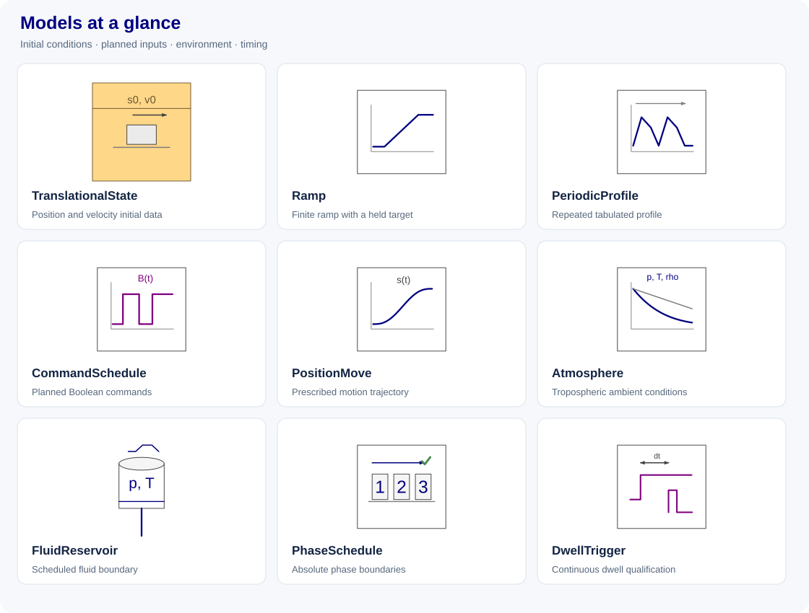

# ScenarioLibrary

**面向 Modelica 仿真的确定性场景库。**

[English](README.md) · 简体中文

ScenarioLibrary 提供初始状态记录、计划输入曲线、环境条件、运行计划和时序组件。通过明确的接口组织可复用的仿真场景，并对照计划输入与模型响应。

**版本：** 1.0.0 · **依赖：** Modelica Standard Library 4.0.0

## 文档

- [English User Guide](docs/UserGuide.md) — 默认英文手册。
- [中文使用手册](docs/UserGuide.zh-CN.md) — 安装、教程及完整模型参考。

## 许可证

[GNU General Public License v3](LICENSE)。
