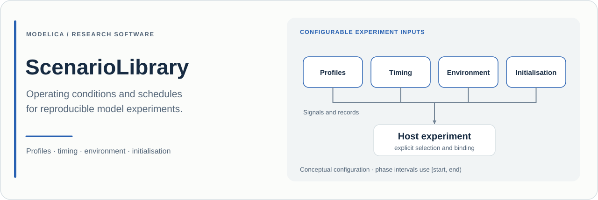

# ScenarioLibrary

**面向 Modelica 仿真的可复用确定性实验条件。**

[English](README.md) · **简体中文**

<!-- learning-guide:start -->
> **[详细学习与使用指南（中英双语 HTML）](docs/LearningGuide.html)** — 包含全部元件参考、接口与参数、逐例讲解和排错说明。下载单文件后用浏览器打开，可切换中文/英文并搜索元件。
<!-- learning-guide:end -->

[](package.mo)
[](package.mo)

## 项目目的

仿真不仅取决于物理模型，也取决于运行条件。ScenarioLibrary 将初始状态、指令轨迹、环境输入、运行模式和任务时序显式建模，使这些条件可以作为 Modelica 组件独立查看、连接和复用，避免分散在本体模型的不同位置。

本库适用于在共同实验条件下比较不同设计、控制器和运行假设的研究。同一计划输入可以驱动多个独立参数化的模型；任务阶段和事件定义则可以明确行为比较所对应的时间范围。实现形式包括记录、函数、信号模块，以及部分物理边界模型。

| 基本信息 | 当前源码 |
| :--- | :--- |
| Modelica 根包 | `ScenarioLibrary` |
| 包版本 | **0.3.0**，见 [package.mo](package.mo) |
| 声明的库依赖 | Modelica Standard Library **4.0.0** |
| 示例模型 | [Examples](Examples) 中共 **8 个** |
| 文档核对基线 | [`ce9e96f`](https://github.com/Ruizhe-Yang/ScenarioLibrary/commit/ce9e96f4ce0cafb082a1cc59af72ccdaccb389c0)，2026 年 11 月 12 日 |

## 实现方式

**通过显式绑定设置初始条件。** [`Initialization.TranslationalState`](Initialization/TranslationalState.mo) 等记录分别保存状态初值与 `fixed` 选择，由本体模型将相应字段绑定到状态变量。仅声明记录不会自动初始化组件；示例展示了需要进行的参数修改。

**为计划输入规定明确的时间语义。** Profiles 包提供阶跃、斜坡、分段常值与线性轨迹、脉冲及有限次数的重复曲线。标准输入模块可以启用可选的 `enable` 输入，此时每次上升沿建立新的局部时间起点；否则使用绝对仿真时间。端点保持和插值方式由具体模块决定。

**将任务阶段与观测窗口建成独立组件。** [`Timing.PhaseSchedule`](Timing/PhaseSchedule.mo) 根据严格递增的边界划分阶段，并输出阶段序号、标识、局部时间和完成标志。阶段和 [`Timing.TimeWindow`](Timing/TimeWindow.mo) 均采用左闭右开的 `[start, end)` 区间。任务结束后，阶段序号归零。[`Timing.LocalClock`](Timing/LocalClock.mo) 提供显式时间参考并支持可选的重复触发；[`Timing.DwellTrigger`](Timing/DwellTrigger.mo) 对每段连续满足条件并达到驻留时间的过程计数一次。

**保留可检查的环境假设。** 例如，[`Environment.Atmosphere`](Environment/Atmosphere.mo) 实现 **0–11,000 m** 范围内的干空气对流层关系，并对高度范围进行断言检查。温度、压力、风速与坡度组件分别提供计划环境量，连接时需要匹配接收模型的单位和坐标约定。

## 模型组织

| 包 | 职责 | 建议入口 |
| :--- | :--- | :--- |
| [Initialization](Initialization) | 机械、电气、热、流体和信号初态记录 | `TranslationalState`、`ElectricalState` |
| [Profiles](Profiles) | 计划标量轨迹与重复运行曲线 | `Ramp`、`PiecewiseLinear`、`Pulse` |
| [Environment](Environment) | 环境信号与物理边界条件 | `Atmosphere`、`Inclination`、`FluidReservoir` |
| [Operating](Operating) | 负载、指令和模式时间表 | `LoadDemand`、`CommandSchedule`、`ModeSchedule` |
| [Timing](Timing) | 阶段、窗口、时钟、驻留与事件序列 | `PhaseSchedule`、`TimeWindow`、`EventSequence` |
| [Utilities](Utilities) | 表格函数、类型和示例视图 | `Functions.TableIndex` |
| [Examples](Examples) | 具有连接关系的完整工作流示例 | `MultiphaseMission` |
| [UsersGuide](UsersGuide) | 建模工具内的信息页面 | `Overview` |

[模型目录](model-catalog.csv) 提供更完整的类清单。具体参数名和连接器应以实际类声明与示例为准。

## 快速开始

克隆到与 Modelica 根包同名的文件夹：

```bash
git clone https://github.com/Ruizhe-Yang/ScenarioLibrary.git
cd ScenarioLibrary
```

在 Modelica 环境中加载 **Modelica 4.0.0**，打开根目录的 `package.mo`，选择 `ScenarioLibrary.Examples.MultiphaseMission`。其实验注解设置为 **0–10 s**、输出间隔 **0.01 s**、容差 **1e-6**。

也可以在仓库目录中使用以下 OpenModelica 脚本入口：

```modelica
loadModel(Modelica, {"4.0.0"});
loadFile("package.mo");
getErrorString();
simulate(ScenarioLibrary.Examples.MultiphaseMission,
  startTime=0, stopTime=10, numberOfIntervals=1000, tolerance=1e-6);
getErrorString();
```

观察 `schedule.phaseIndex`、`schedule.localTime`、`demand` 和 `finished`。源码中的阶段边界为 `{0, 1, 3, 7, 10}`，可据此核对阶段切换。随后查看 `ReusableScenario`：同一个斜坡输入连接到时间常数分别为 **0.2 s** 和 **0.5 s** 的两个一阶模型。上述数值均为源码中的示例设置，不是性能测试结果。

## 示例索引

链接指向完整的 Modelica 示例；时间为示例声明的仿真终止时间。

| 示例 | 研究内容 | 主要观察变量 | 终止时间 |
| :--- | :--- | :--- | ---: |
| [MultiphaseMission](Examples/MultiphaseMission.mo) | 四阶段任务与按阶段变化的计划负载 | `schedule.phaseIndex`、`schedule.localTime`、`demand`、`finished` | 10 s |
| [MechanicalInitialization](Examples/MechanicalInitialization.mo) | 独立的平动与转动初始状态 | `translationalHost.s`、`.v`；`rotationalHost.phi`、`.w` | 5 s |
| [ElectricalThermalInitialization](Examples/ElectricalThermalInitialization.mo) | 电容电压、电感电流与温度初值 | `capacitor.v`、`inductor.i`、`thermal.T` | 5 s |
| [LoadAndCommandSchedules](Examples/LoadAndCommandSchedules.mo) | 共同时间基准下的实数、布尔和整数时间表 | `loadProfileOutput`、`commandOutput`、`modeOutput` | 6 s |
| [EnvironmentalConditions](Examples/EnvironmentalConditions.mo) | 大气参数与指定的环境输入 | `seaPressure`、`hillPressure`、`upperPressure`、`gradeReadback` | 5 s |
| [PhaseQualifiedWindows](Examples/PhaseQualifiedWindows.mo) | 阶段门控与绝对时间窗口的对应关系 | `phaseActive`、`timeActive`、`localElapsed` | 8 s |
| [RepeatedEventsAndDwell](Examples/RepeatedEventsAndDwell.mo) | 计划事件、驻留判定与时钟重启 | `plannedCount`、`dwellCount`、`elapsed` | 6 s |
| [ReusableScenario](Examples/ReusableScenario.mo) | 同一输入在两个动态本体中的复用 | `scenario.y`、`fastResponse`、`slowResponse` | 6 s |

## 科研使用建议

将场景定义与本体模型版本一起保存，记录初态绑定、曲线参数、环境假设、阶段边界、求解器设置及使用的源码提交。比较不同方案时，应共享同一个场景实例，或使用相同的已记录场景参数，并明确说明有意设置的差异。

需要区分**计划条件**与**观测行为**。计划指令和完成标志表达实验要求，不代表物理系统已经完成相应任务；是否完成应由本体输出和明确的评价规则确定。

引用软件时，请注明 **ScenarioLibrary，版本 0.3.0**、仓库地址以及使用的提交。[提交历史](https://github.com/Ruizhe-Yang/ScenarioLibrary/commits/main/)与[更新记录](CHANGELOG.md)可用于版本追踪。

## 适用范围与假设

本库定义确定性条件，不负责启动批量实验，也不会从本体系统中自动推断任务。初态记录的绑定必须与本体方程一致；对初始状态施加过多约束可能导致模型不可求解。环境模型具有各自的有效范围；名称相近的坡度组件可能采用不同符号约定，连接前应阅读实际声明。时序和输入组件描述指定场景，本身不构成系统安全性的证明。

## 许可证与贡献

仓库包含 [GNU 通用公共许可证第 3 版](LICENSE)。提交问题或改进时，请附上版本或提交、Modelica 工具及版本、最小复现模型、预期行为和相关输出。场景语义、边界条件与示例清晰度方面的改进有助于科研复用。
