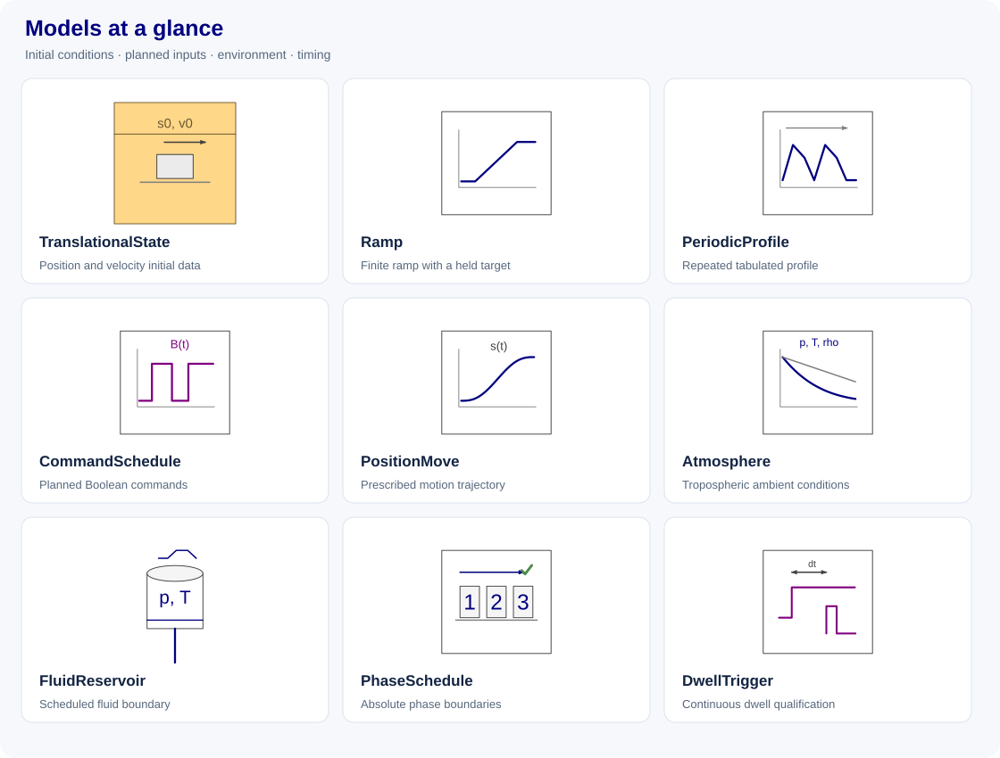

# ScenarioLibrary v1.0.0 — User Guide

English · [简体中文](UserGuide.zh-CN.md)

## Contents

- [1. Scope and package structure](#1-scope-and-package-structure)
- [2. Load the library and inspect the first scenario](#2-load-the-library-and-inspect-the-first-scenario)
- [3. Bind initial-state records](#3-bind-initial-state-records)
- [4. Generate and restart a planned profile](#4-generate-and-restart-a-planned-profile)
- [5. Configure operating and environmental conditions](#5-configure-operating-and-environmental-conditions)
- [6. Combine phases and qualified windows](#6-combine-phases-and-qualified-windows)
- [7. Choose clocks, events and status logic](#7-choose-clocks-events-and-status-logic)
- [8. Compare scenario inputs with model responses](#8-compare-scenario-inputs-with-model-responses)
- [9. Complete model and class reference](#9-complete-model-and-class-reference)
- [10. Included examples](#10-included-examples)
- [11. Troubleshooting and modelling limits](#11-troubleshooting-and-modelling-limits)
- [12. Documentation and further reading](#12-documentation-and-further-reading)

## 1. Scope and package structure

ScenarioLibrary defines deterministic initial conditions, planned inputs, environmental assumptions and timing for Modelica simulations. It provides **57 scenario components and initial-state records**, with **8 complete examples**. The full source contains **88 Modelica files**, including packages, functions, types and in-tool guidance. Its only library dependency is **Modelica Standard Library 4.0.0**.

A scenario element has an explicit role: a record supplies data for parameter bindings, a signal block provides a planned or condition-dependent value, and a physical boundary model imposes a network relation. Connect or bind that element to the receiving model according to its interface.

| Package | Components / records | Contents |
| --- | --- | --- |
| [`Initialization`](../Initialization/package.mo) | 6 | Initial-state records for mechanical, electrical, thermal, fluid and signal quantities. |
| [`Profiles`](../Profiles/package.mo) | 11 | Scalar trajectories, finite repeated profiles and startup/hold/shutdown sequences. |
| [`Environment`](../Environment/package.mo) | 14 | Environmental signals, gravity assumptions and physical fluid boundaries. |
| [`Operating`](../Operating/package.mo) | 14 | Load, command and mode schedules, prescribed motion and operating points. |
| [`Timing`](../Timing/package.mo) | 12 | Phase schedules, clocks, windows, dwell qualification and lifecycle status. |

`Utilities` supplies table functions, enumerations and the example phase-load view. `Examples` demonstrates complete connections and initialisation bindings; `UsersGuide` provides concise guidance inside the modelling tool.



The previews use the existing local Modelica `Icon` graphics, with instance and parameter labels omitted. The original model icons, diagrams and connector positions are retained.

## 2. Load the library and inspect the first scenario

1. Extract the archive and retain the complete `ScenarioLibrary` directory.
2. Load Modelica 4.0.0 in the modelling environment, then open `ScenarioLibrary/package.mo`.
3. Open `ScenarioLibrary.Examples.MultiphaseMission` and inspect its Diagram view.
4. Use the stored experiment: 0–10 s, output interval 0.01 s and tolerance `1e-6`.
5. Plot `schedule.phaseIndex`, `schedule.phaseId`, `schedule.localTime`, `demand` and `finished`.

The boundaries `{0,1,3,7,10}` divide the run into four half-open phases. The load is zero, rises linearly, holds at one and then decreases linearly. The following values are derived from the example equations and can be compared with the simulator output.

| Simulation instant | Phase index | Local phase time | Planned demand | Finished |
| --- | --- | --- | --- | --- |
| 0.5 s | 1 | 0.5 s | 0 | false |
| 2 s | 2 | 1 s | 0.5 | false |
| 4 s | 3 | 1 s | 1 | false |
| 8.5 s | 4 | 1.5 s | 0.5 | false |
| 10 s | 0 | 0 s | 0 | true |

`finished` reports that the schedule reached its final boundary. A physical achievement criterion must be defined from the receiving model's response. The planned load alone does not supply that criterion.

For OpenModelica, run these commands from the directory containing the `ScenarioLibrary` folder:

```modelica
loadModel(Modelica, {"4.0.0"});
loadFile("ScenarioLibrary/package.mo");
checkModel(ScenarioLibrary.Examples.MultiphaseMission);
simulate(ScenarioLibrary.Examples.MultiphaseMission,
  startTime=0, stopTime=10, numberOfIntervals=1000,
  tolerance=1e-6);
getErrorString();
```

## 3. Bind initial-state records

The six `Initialization` records store start values and initialisation choices. Physical-state records provide independent `fixed` flags; `SignalState` provides an `initType` option. Merely declaring a record does not initialise a component. Bind each field to the corresponding state modifier, as in this complete example saved as `FirstInitialState.mo`.

```modelica
within;
model FirstInitialState "Bind an initial state to a spring-supported mass"
  parameter ScenarioLibrary.Initialization.TranslationalState initialState(
    s_start=0.1,
    v_start=0,
    fixedS=true,
    fixedV=true);
  Modelica.Mechanics.Translational.Components.Fixed reference;
  Modelica.Mechanics.Translational.Components.Spring spring(c=10);
  Modelica.Mechanics.Translational.Components.Mass body(
    m=1,
    s(start=initialState.s_start, fixed=initialState.fixedS),
    v(start=initialState.v_start, fixed=initialState.fixedV));
equation
  connect(reference.flange, spring.flange_a);
  connect(spring.flange_b, body.flange_a);
  annotation(experiment(StartTime=0, StopTime=5,
    Interval=0.01, Tolerance=1e-6));
end FirstInitialState;
```

The mass begins at `body.s=0.1 m` and `body.v=0 m/s`. Plot those states and the spring force. The record remains configuration data; it does not reset the mass during the simulation.

For a state variable, `start` supplies an initial value or guess; `fixed=true` imposes that value during initialisation. Choose independent initial states consistent with the physical equations. Setting every visible variable to a fixed value can overconstrain a network. Where fixed flags are provided, bind them explicitly just like the numerical fields.

| Record | Typical binding |
| --- | --- |
| `TranslationalState` | Position and velocity starts on a translational body. |
| `RotationalState` | Angle and angular-velocity starts on an inertia. |
| `ElectricalState` | Capacitor voltage and inductor current, in the appropriate electrical components. |
| `ThermalState` | Temperature start on a thermal capacity. |
| `FluidState` | Compatible pressure, temperature and composition starts on the chosen fluid model. |
| `SignalState` | Initial signal or controller-state value where the receiving block exposes such a setting. |

The record does not choose a medium, state selection or initialisation strategy for a fluid component. Bind only the thermodynamic quantities required by that component and keep them mutually consistent.

## 4. Generate and restart a planned profile

The basic `Step`, `Ramp`, `Sine`, `Pulse`, `PiecewiseConstant`, `PiecewiseLinear` and `PeriodicProfile` blocks support an optional `enable` input. With `useEnableInput=false`, their time argument is absolute simulation time. With it enabled, each rising edge establishes a new local time origin. Disabling immediately returns `baseline`; it does not pause the profile for later continuation.

Save this complete model as `FirstEnabledProfile.mo`:

```modelica
within;
model FirstEnabledProfile "Restart a planned ramp on each enable edge"
  Modelica.Blocks.Sources.BooleanExpression request(
    y=(time >= 1 and time < 2.5) or
      (time >= 3 and time < 5));
  ScenarioLibrary.Profiles.Ramp profile(
    useEnableInput=true,
    baseline=0,
    height=1,
    startTime=0,
    duration=1);
  Modelica.Blocks.Continuous.FirstOrder response(
    T=0.25,
    y_start=0,
    initType=Modelica.Blocks.Types.Init.InitialState);
equation
  connect(request.y, profile.enable);
  connect(profile.y, response.u);
  annotation(experiment(StartTime=0, StopTime=6,
    Interval=0.01, Tolerance=1e-6));
end FirstEnabledProfile;
```

Plot `request.y`, `profile.y` and `response.y`. The first ramp starts at 1 s and the second starts at 3 s. Each takes one second to reach its target. The receiving first-order block retains its own dynamic state when the profile restarts.

| Simulation instant | Expected profile output |
| --- | --- |
| 1.5 s | 0.5 |
| 2.25 s | 1 |
| 2.75 s | 0 |
| 3.5 s | 0.5 |
| 5.25 s | 0 |

Read the endpoint rule of the selected profile. While enabled, `PiecewiseLinear` holds its first value before its first node; `PiecewiseConstant` uses `baseline` there. `PeriodicProfile` can hold table endpoints in unused portions of a period, whereas `PeriodicLoadCycle` requires its table to span the whole period. Repeated startup cycles include idle time between active sequences.

Generic scalar profiles do not assign a physical unit to an application. Give their values the meaning and scale expected by the receiving connector. For a table, configure the declared size and ordered nodes together with its values.

## 5. Configure operating and environmental conditions

Choose a specialised component when its outputs match the quantities used by the model. Operating schedules include real load, Boolean commands, integer or enumerated modes, motion commands, valve opening, thermal trajectories and demand maps.

| Need | Starting components | Configuration point |
| --- | --- | --- |
| Load, power and sweep requests | `LoadDemand`, `PowerDemand`, `ScheduledLoadEnvelope` | Configure the time table and interpolation for `LoadDemand`; basePower, ratings and fraction inputs in [0,1] for `PowerDemand`; sweep frequencies and envelope timing for `ScheduledLoadEnvelope`. `LoadDemand.unitText` is metadata; its bounds validate values without clipping. |
| Commands and modes | `CommandSchedule`, `ModeSchedule`, `MultiModeSchedule` | Use the declared Boolean, integer or enumeration output and read the pre-start and endpoint rules. |
| Prescribed movement | `PositionMove`, `SpeedSweep` | Connect the planned position or speed to an appropriate command input and inspect the receiving motion separately. |
| Flow, valve and torque requests | `ReversibleFlowDemand`, `ValveOpeningProfile`, `TorqueSpeedMap` | Preserve the documented sign and magnitude conventions. |
| Environmental signals | `Temperature`, `Pressure`, `Wind`, `FluidBoundary` | Connect the outputs to suitable signal-driven boundaries or other receiving inputs. |
| Physical fluid boundary | `FluidReservoir` | Select a compatible medium and connect its fluid port. It is an ideal scheduled boundary without finite stored inventory. |

The environmental models have individual assumptions:

| Component | Assumption or convention |
| --- | --- |
| `Atmosphere` | Dry-air tropospheric relation restricted to heights from 0 to 11000 m. |
| `AmbientPressureProfile` | Isothermal exponential relation over −500 to 6000 m; it is distinct from `Atmosphere`. |
| `Inclination` | Tangent direction is positive uphill; positive angle gives `alongSlope=-g*sin(alpha)`. |
| `GravitySetting` | Grade is positive downhill; its applied force is `carriedMass*gravity*sin(grade)`. |
| `PositionGradeProfile` | Interpolates grade by position and holds endpoint grades beyond the table. |
| `AmbientTemperatureCycle`, `WindProfile` | Peak time and phase origin specify waveform phase, not an activation interval. |
| `ScheduledIrradiance` | `illuminated` marks a scheduled light interval and can be true while irradiance is still zero. |

Keep physical boundaries separate from signal descriptions in the configuration. A pressure signal does not constrain a fluid port until it is connected to a boundary model that uses that signal. Likewise, a motion command is not the measured motion of a body.

## 6. Combine phases and qualified windows

`PhaseSchedule` uses strictly increasing absolute boundaries. `phaseIndex` is the ordinal position in the schedule; `phaseId` is a configurable label. Each phase includes its start and excludes its end. Before the first phase and after completion, the index and local time are zero. Completion also returns the identifier to zero.

This example enables a ramp only in the second phase:

```modelica
within;
model FirstPhaseWindow "Enable a planned load during one phase"
  ScenarioLibrary.Timing.PhaseSchedule schedule(
    n=3,
    boundaries={0,2,5,8},
    phaseIds={10,20,30});
  ScenarioLibrary.Timing.PhaseWindow window(targetPhase=2);
  ScenarioLibrary.Profiles.Ramp plannedLoad(
    useEnableInput=true,
    baseline=0,
    height=1,
    startTime=0,
    duration=1);
equation
  connect(schedule.phaseIndex, window.phaseIndex);
  connect(window.active, plannedLoad.enable);
  annotation(experiment(StartTime=0, StopTime=8,
    Interval=0.01, Tolerance=1e-6));
end FirstPhaseWindow;
```

Plot `schedule.phaseIndex`, `schedule.phaseId`, `window.active` and `plannedLoad.y`. The second phase has index 2 and identifier 20. `PhaseWindow.targetPhase` selects the index, so its value is 2. The load begins rising at 2 s, reaches one at 3 s, holds until 5 s and returns to baseline when the window closes.

Use `TimeWindow` for an absolute interval and `PhaseWindow` for a phase-index condition. `PhaseScheduler` and `BranchingPhaseSchedule` provide other transition rules; read their input and boundary semantics before substituting them. The example view `Utilities.Views.PhaseLoad` has a fixed 2 s rise and 3 s fall; adapt the surrounding schedule deliberately when using that view.

## 7. Choose clocks, events and status logic

Clock and status components serve different purposes. Select the reset, pause and completion behaviour explicitly.

| Component | Behaviour to use |
| --- | --- |
| `LocalClock` | Use a reference time or conditional start input. Accepted retriggers can reset its origin. Falling `start` does not pause elapsed time. `stopTime` is an absolute simulation-time cap. |
| `MissionClock` | Accumulates enabled time and supports pause/resume. It has no reset input; reported elapsed time is capped at duration. |
| `EventSequence` | Reports scheduled events reached and their identifiers; inspect the event count when detecting progression. |
| `DwellTrigger` | Qualifies a continuously true condition after `dwellTime`. `fired` stays true until the condition clears; the count increases once per qualifying interval. |
| `AccessWindowSchedule` | Describes scheduled access windows. `hasNext` refers to a strictly future start, so it can be false during the final active window. |
| `MissionLifecycle` | Tracks explicit lifecycle requests with defined event priority and resets active-time accumulation on an accepted new run. |
| `TaskStatus` | Evaluates the supplied start, completion and abort requests using its declared precedence and eligibility rules. |

In `RepeatedEventsAndDwell`, the short condition `[1,1.2)` s does not satisfy the 0.3 s dwell. The interval `[2,2.7)` s qualifies at 2.3 s. The same condition restarts the local clock at 1 s and 2 s; its falling edges do not stop that clock. Plot the condition, dwell flag, counts and elapsed time together to see these distinctions.

For status blocks, connect the application conditions that define start, completion, abort and recovery. The block interprets those inputs according to its state logic; it does not infer the conditions from an unrelated plant model. Simultaneous requests and requests already true at initialisation require the documented priority rules.

## 8. Compare scenario inputs with model responses

Record the initial-state bindings, profile parameters, environment assumptions and timing rules used for each run. When comparing alternative model parameters, share the same scenario input or use the same explicit settings, and keep initial conditions and solver settings consistent.

Inspect both sides of the connection: the requested value from the scenario and the resulting state or measurement in the receiving model. `ReusableScenario` illustrates this with one ramp and two first-order responses. Arrival, completion and restart markers in prescribed schedules report their own mathematical conditions, rather than measured system achievement.

At discontinuities, compare values immediately before and at a scheduled node. A linear segment, an immediately held step and a local-time restart have different meanings. Read counters alongside Boolean flags when one qualifying interval should be counted only once.

Environmental validity and sign conventions remain part of the model assumptions. Choose table values, finite sequence lengths and boundary magnitudes suitable for the application. The reference below lists the individual configuration points and restrictions for every source file.

## 9. Complete model and class reference

The tables cover all 88 source files, grouped by package. Each link opens the corresponding Modelica definition. Read the configuration and limits alongside the parameter dialogue when selecting a record, signal block, boundary or timing component.

### 9.1. ScenarioLibrary

| Class | Purpose | Configuration and limits |
| --- | --- | --- |
| [`ScenarioLibrary`](../package.mo) | Deterministic initial conditions, planned inputs and timing | Load package.mo with Modelica 4.0.0 and start with Examples.MultiphaseMission. |

### 9.2. Initialization

| Class | Purpose | Configuration and limits |
| --- | --- | --- |
| [`Initialization`](../Initialization/package.mo) | Records for explicit initial-state bindings | Choose a record and bind its fields to the host model explicitly. |
| [`ElectricalState`](../Initialization/ElectricalState.mo) | Electrical voltage and current initial-state settings | Bind v_start/fixedV and i_start/fixedI to the corresponding host state modifiers. The record stores settings only; it does not initialise or reset a component without explicit bindings. |
| [`FluidState`](../Initialization/FluidState.mo) | Fluid pressure, temperature and composition initial-state settings | Bind p_start, T_start and X_start with the corresponding flags to the selected host initialisation parameters. The record stores settings only; it does not initialise or reset a component without explicit bindings. Composition validity and host initialisation consistency are not checked by this record. |
| [`RotationalState`](../Initialization/RotationalState.mo) | Independent initial angle and angular velocity settings | Apply the two start/fixed pairs to the rotational host states. The record stores settings only; it does not initialise or reset a component without explicit bindings. |
| [`SignalState`](../Initialization/SignalState.mo) | Signal start value and initialisation option | Map x_start and initType to the actual initialisation parameters of the receiving block. The record stores settings only; it does not initialise or reset a component without explicit bindings. |
| [`ThermalState`](../Initialization/ThermalState.mo) | Temperature initial-state setting and fixed flag | Bind T_start and fixedT to the thermal state start and fixed modifiers. The record stores settings only; it does not initialise or reset a component without explicit bindings. |
| [`TranslationalState`](../Initialization/TranslationalState.mo) | Independent initial position and velocity settings | Apply the two start/fixed pairs to the translational host states. The record stores settings only; it does not initialise or reset a component without explicit bindings. |

### 9.3. Profiles

| Class | Purpose | Configuration and limits |
| --- | --- | --- |
| [`Profiles`](../Profiles/package.mo) | Scalar profiles and finite operating cycles | Choose the required waveform and check its time base, endpoint values and repetition rules. |
| [`PeriodicLoadCycle`](../Profiles/PeriodicLoadCycle.mo) | Finite repetition of a complete load table | Provide points[n,2] spanning one full period; set cycles and standby, then inspect y and cycle. The final table endpoint is approached from the left; a cycle boundary selects local time zero. |
| [`PeriodicProfile`](../Profiles/PeriodicProfile.mo) | Finite repetition of a linearly interpolated profile | Set the table, period, nCycles and endValue. Each cycle starts again at local time zero. Unequal values at the cycle ends can produce a jump at repetition boundaries. |
| [`PiecewiseConstant`](../Profiles/PiecewiseConstant.mo) | Right-continuous table with a configurable initial value | Supply matching times and values arrays of length n; each node selects its new value at the node time. |
| [`PiecewiseLinear`](../Profiles/PiecewiseLinear.mo) | Linear time interpolation with endpoint holds | Supply matching times and values arrays; use baseline for the disabled output, not the enabled pre-table value. The enabled output before the first node is values[1], unlike PiecewiseConstant. |
| [`Pulse`](../Profiles/Pulse.mo) | Finite sequence of half-open rectangular pulses | Set width, period and nCycles with width<=period. y returns to baseline between pulses and after the sequence. |
| [`Ramp`](../Profiles/Ramp.mo) | Finite linear ramp with a held final value | Set startTime, positive duration and signed height; plot y against the selected time base. |
| [`RepeatingStartupCycle`](../Profiles/RepeatingStartupCycle.mo) | Repeated start-up, hold, shutdown and idle sequence | Set riseTime, holdTime, fallTime, idleTime and cycles. Observe y together with cycle and completed. A nonzero cycle index includes the idle part and does not imply a non-standby demand. |
| [`ScheduledLoadEnvelope`](../Profiles/ScheduledLoadEnvelope.mo) | Linear frequency sweep with a finite amplitude envelope | Set the frequency range, duration, edgeTime, meanLoad and amplitude; connect load in the receiving signal unit. The amplitude envelope is piecewise linear; smooth output derivatives at all boundaries are not guaranteed. |
| [`Sine`](../Profiles/Sine.mo) | Sinusoidal profile within a half-open time window | Set amplitude, frequency, phase and the window; read y. An empty window produces the baseline. Window boundaries may introduce a jump when the sinusoidal contribution is nonzero there. |
| [`StartupHoldShutdown`](../Profiles/StartupHoldShutdown.mo) | Linear start-up, hold and shutdown demand | Set standby, rated and the three durations; connect y to the receiving demand input. |
| [`Step`](../Profiles/Step.mo) | Scheduled step with an optional local time origin | Set baseline, height and startTime; connect enable only when useEnableInput=true, then read y. |

### 9.4. Environment

| Class | Purpose | Configuration and limits |
| --- | --- | --- |
| [`Environment`](../Environment/package.mo) | Environmental signals and physical boundaries | Select the required environmental quantity or physical boundary. |
| [`AmbientPressureProfile`](../Environment/AmbientPressureProfile.mo) | Isothermal atmospheric pressure from an altitude signal | Connect altitude, set seaLevelPressure and scaleHeight, and read pressure. Altitude is restricted to -500–6000 m; this relation differs from the lapse-rate Atmosphere model. |
| [`AmbientTemperatureCycle`](../Environment/AmbientTemperatureCycle.mo) | Periodic ambient temperature with a prescribed peak time | Set the two temperature bounds, period and any peakTime; connect temperature to the receiving boundary or signal input. peakTime sets phase, not an activation time. |
| [`Atmosphere`](../Environment/Atmosphere.mo) | Dry-air troposphere temperature, pressure and density | Connect height in metres and read T, p and rho for a dry-air boundary assumption. The asserted validity range is 0–11000 m; moisture and weather variations are not represented. |
| [`FluidBoundary`](../Environment/FluidBoundary.mo) | Constant pressure, temperature and composition signals | Set pressure, temperature, nX and fractions; connect p, T and X to compatible boundary inputs. The block contains no fluid connector or reservoir state. |
| [`FluidReservoir`](../Environment/FluidReservoir.mo) | Scheduled pressure and temperature fluid boundary | Choose Medium, connect port and set standby/rated targets together with startTime, startupTime, operatingTime and shutdownTime. Pressure and temperature share one normalised schedule; the reservoir has no finite storage capacity. |
| [`Gravity`](../Environment/Gravity.mo) | Constant gravity vector in a chosen reference frame | Set g in the receiving coordinate frame and connect gVector to the corresponding signal interface. The reference-frame convention is supplied by the application. |
| [`GravitySetting`](../Environment/GravitySetting.mo) | Tangential gravitational load for a prescribed grade | Connect grade and flange, set carriedMass and gravity, and inspect force alongside the body motion. Positive grade produces a positive applied force; this sign convention differs from Inclination. |
| [`Inclination`](../Environment/Inclination.mo) | Gravity components for an upward-positive slope | Set alpha and g, then use alongSlope and normal as signed acceleration components. The tangent is upward-positive, unlike the downhill-positive grade used by GravitySetting. |
| [`PositionGradeProfile`](../Environment/PositionGradeProfile.mo) | Position-based linear interpolation of path grade | Fill the two-column stations table, connect position and use grade with the chosen slope-sign convention. Endpoint grades are held outside the position range; the table itself does not impose a downhill/uphill convention. |
| [`Pressure`](../Environment/Pressure.mo) | Piecewise linear absolute-pressure schedule | Set n, times and positive values; connect y in pascals. The table uses absolute simulation time and holds its endpoints. |
| [`ScheduledIrradiance`](../Environment/ScheduledIrradiance.mo) | Repeated light intervals with linear irradiance transitions | Set startTime, period, lightTime, transitionTime and fullIrradiance; use illuminated as a schedule flag and irradiance as the physical input. illuminated does not test for strictly positive irradiance, including when fullIrradiance=0. |
| [`Temperature`](../Environment/Temperature.mo) | Piecewise linear absolute-temperature schedule | Set n, times and positive values, then connect y to the temperature input. The table uses absolute simulation time and holds its endpoints. |
| [`Wind`](../Environment/Wind.mo) | Three-component piecewise linear wind schedule | Set times and the three velocity columns of values; connect vx, vy and vz in a consistent frame. Signed vector components differ from the nonnegative scalar speed provided by WindProfile. |
| [`WindProfile`](../Environment/WindProfile.mo) | Nonnegative scalar wind speed with sinusoidal modulation | Set meanWind, modulation, period and phaseOrigin; connect speed to a scalar wind-speed input. phaseOrigin sets phase rather than activation; speed remains nonnegative for valid parameters. |

### 9.5. Operating

| Class | Purpose | Configuration and limits |
| --- | --- | --- |
| [`Operating`](../Operating/package.mo) | Operating commands, modes and demand schedules | Choose the required signal type, units and timing rule before connecting the operating command. |
| [`CommandSchedule`](../Operating/CommandSchedule.mo) | Right-continuous Boolean command schedule | Provide matching times and Boolean values arrays and a pre-table baseline; connect y to the command input. |
| [`DutyCycle`](../Operating/DutyCycle.mo) | Finite schedule of running and idle intervals | Set startTime, period, duty and cycles; read running separately from completed. |
| [`HystereticStandby`](../Operating/HystereticStandby.mo) | Hysteretic selection of rated and standby operation | Connect plannedDemand, order enterStandby below enterRun and set initialRun for an initial value inside the band. |
| [`LoadDemand`](../Operating/LoadDemand.mo) | Range-checked load table with selectable interpolation | Set matching times and values, choose method and declare lower/upper; interpret y in the intended signal unit. Bounds validate values; unitText does not perform unit conversion or change y's unit annotation. |
| [`ModeSchedule`](../Operating/ModeSchedule.mo) | Right-continuous integer mode schedule | Set times, integer values and baseline; use y as the receiving model's mode code. |
| [`MultiModeSchedule`](../Operating/MultiModeSchedule.mo) | Duration-based mode and load-fraction schedule | Provide durations, modes and loadFraction arrays of matching length n; observe phase, mode, demand and completed. |
| [`OperatingPoint`](../Operating/OperatingPoint.mo) | Constant operating vector with channel metadata | Set values, names, units and per-channel bounds with length n; connect the matching elements of y. |
| [`PositionMove`](../Operating/PositionMove.mo) | Quintic position command with zero endpoint velocity and acceleration | Set both positions, startTime and duration; connect position or velocity and interpret arrived as a schedule marker. |
| [`PowerDemand`](../Operating/PowerDemand.mo) | Base power plus independently weighted task demands | Connect all fraction inputs, set basePower and ratings, and use power as the load command. |
| [`ReversibleFlowDemand`](../Operating/ReversibleFlowDemand.mo) | Finite sinusoidal mass-flow demand about a mean value | Set meanFlow, amplitude, period and cycles; connect requestedFlow to a compatible flow-command input. |
| [`SpeedSweep`](../Operating/SpeedSweep.mo) | Logarithmic angular-speed sweep with held endpoints | Set positive endpoint speeds and duration; use speed and acceleration as consistent motion commands. |
| [`ThermalSoakSchedule`](../Operating/ThermalSoakSchedule.mo) | Exponential thermal reference with soak and restart markers | Set the temperatures, shutdownAt, coolingTime and soakDuration; read temperature and timing flags separately. |
| [`TorqueSpeedMap`](../Operating/TorqueSpeedMap.mo) | Signed opposing torque from an absolute-speed table | Supply points[n,2] in rad/s and N.m, connect signed speed and pass torque to an appropriate torque source. |
| [`ValveOpeningProfile`](../Operating/ValveOpeningProfile.mo) | Cubic opening and closing commands between two settings | Set both openings and transition durations, with closeAt>=openAt+openingTime; connect opening to the valve command. |

### 9.6. Timing

| Class | Purpose | Configuration and limits |
| --- | --- | --- |
| [`Timing`](../Timing/package.mo) | Clocks, phases, windows and declared task states | Choose the timing interface before combining schedules and conditions. |
| [`AccessWindowSchedule`](../Timing/AccessWindowSchedule.mo) | Ordered access windows with advance preparation | Set starts, ends and leadTime; read activeIndex for access and preparing for advance preparation. hasNext can be false while the final window is active; it describes a future start, not current access. |
| [`BranchingPhaseSchedule`](../Timing/BranchingPhaseSchedule.mo) | Single-branch phase schedule with a boundary-sampled decision | Connect jumpRequested and set durations, branchFrom and branchTo. Inspect phase, elapsed, jumped and completed. The jump decision is taken only at the selected boundary; later request changes do not alter it. |
| [`DwellTrigger`](../Timing/DwellTrigger.mo) | Qualify a continuous dwell and count each occurrence | Connect condition, set dwellTime and use count to detect successive qualified occurrences. fired is a sustained qualification flag, not a one-step event pulse. |
| [`EventSequence`](../Timing/EventSequence.mo) | Count scheduled events and retain the latest identifier | Set times and eventIds; detect a new scheduled event from a change in eventCount. The outputs are a cumulative count and a held identifier rather than event pulses. |
| [`LocalClock`](../Timing/LocalClock.mo) | Local elapsed time with optional restart input | Use referenceTime for a fixed origin, or enable and connect start for triggered timing; choose retrigger and the absolute stopTime. A trigger at or after stopTime can reset elapsed to zero; start falling does not pause the clock. |
| [`MissionClock`](../Timing/MissionClock.mo) | Pauseable mission clock with a bounded reported duration | Connect enable, set startTime, duration and speed, then observe elapsed, running and completed. Reported time is capped, but the internal accumulated state is not; the clock does not restart. |
| [`MissionLifecycle`](../Timing/MissionLifecycle.mo) | Event-driven mission state with pause, recovery and restart | Connect all six event inputs and observe state, running, runCount and elapsedActive. After abort, request recover before a new start. Event priority is abort, complete, pause, recover, resume, start. Initialisation processes only the start/abort condition. |
| [`PhaseSchedule`](../Timing/PhaseSchedule.mo) | Absolute phase boundaries with explicit completion | Set boundaries and phaseIds; use phaseIndex for ordinal gating and phaseId for the configured phase label. The final boundary completes the schedule; it does not hold the last phase index. |
| [`PhaseScheduler`](../Timing/PhaseScheduler.mo) | Consecutive phases defined by positive durations | Set startTime and durations, then use phase with elapsed or remaining to select planned operations. |
| [`PhaseWindow`](../Timing/PhaseWindow.mo) | Boolean qualification of one phase index | Connect an ordinal phase index and set targetPhase to the required stage number. Use the ordinal index rather than an arbitrary phaseId unless the identifiers deliberately match. |
| [`TaskStatus`](../Timing/TaskStatus.mo) | Declared task state with abort and completion priority | Connect start, complete and abort; read status for the declared state and running for the active-state flag. The current input levels are evaluated at every recognised event; abort outranks completion, which outranks start. |
| [`TimeWindow`](../Timing/TimeWindow.mo) | Absolute half-open time window | Set startTime and endTime and use active to qualify the required observation or operation. |

### 9.7. Utilities

| Class | Purpose | Configuration and limits |
| --- | --- | --- |
| [`Utilities`](../Utilities/package.mo) | Shared scenario functions, types and views | Browse Functions, Types and Views for the required shared definition. |

### 9.8. Utilities.Functions

| Class | Purpose | Configuration and limits |
| --- | --- | --- |
| [`Functions`](../Utilities/Functions/package.mo) | Ordered-table lookup and interpolation | Use TableIndex for held entries and Interpolate for linear values. |
| [`Interpolate`](../Utilities/Functions/Interpolate.mo) | Linear interpolation with endpoint holds | Call Interpolate(t, times, values) with a nonempty, strictly increasing coordinate table and equally sized values. Ordering is a caller requirement; only non-emptiness is asserted internally. |
| [`TableIndex`](../Utilities/Functions/TableIndex.mo) | Right-continuous index in an ordered coordinate table | Call TableIndex(t, times) to locate the latest reached table entry; handle index zero before indexing another array. |

### 9.9. Utilities.Types

| Class | Purpose | Configuration and limits |
| --- | --- | --- |
| [`Types`](../Utilities/Types/package.mo) | Scenario state and interpolation enumerations | Use the enumeration declared by the receiving component. |
| [`MissionState`](../Utilities/Types/MissionState.mo) | Externally declared mission lifecycle states | Use MissionState for lifecycle status; inspect the lifecycle block for transition rules. |
| [`OperatingMode`](../Utilities/Types/OperatingMode.mo) | Named planned operating conditions | Use OperatingMode values where an operating-condition enumeration is declared. |
| [`ProfileInterpolation`](../Utilities/Types/ProfileInterpolation.mo) | Profile interpolation policy | Set the receiving profile interpolation parameter to Constant or Linear. |
| [`TaskState`](../Utilities/Types/TaskState.mo) | Externally declared task states | Use TaskState for declared task status. |

### 9.10. Utilities.Views

| Class | Purpose | Configuration and limits |
| --- | --- | --- |
| [`Views`](../Utilities/Views/package.mo) | Compact views of planned scenario signals | Use PhaseLoad with its documented phase and local-time convention. |
| [`PhaseLoad`](../Utilities/Views/PhaseLoad.mo) | Fixed four-phase load view | Connect phaseIndex and nonnegative localTime from a phase schedule; read demand for the fixed four-stage profile. The phase-2 rise and phase-4 fall are fixed at 2 s and 3 s; negative localTime is not clamped. |

### 9.11. UsersGuide

| Class | Purpose | Configuration and limits |
| --- | --- | --- |
| [`UsersGuide`](../UsersGuide/package.mo) | User's guide | Start with GettingStarted, then review the conventions and modelling limits. |
| [`Conventions`](../UsersGuide/Conventions.mo) | Time references, record bindings and signal meaning | Check units, time reference, boundary rules and the meaning of each status output before connecting components. |
| [`GettingStarted`](../UsersGuide/GettingStarted.mo) | Load the library and inspect a first scenario | Run MultiphaseMission first, then ReusableScenario to separate the planned input from the model response. |
| [`Limitations`](../UsersGuide/Limitations.mo) | Initialisation and environmental modelling limits | Check independent initial states, table definitions, environmental validity and explicit achievement criteria. |
| [`Overview`](../UsersGuide/Overview.mo) | Scope and package organisation | Choose the package by the scenario interface required by the model. |

### 9.12. Examples

| Class | Purpose | Configuration and limits |
| --- | --- | --- |
| [`Examples`](../Examples/package.mo) | Complete examples of scenario configuration | Choose an example by its initialisation, profile, environment or timing interface. |
| [`ElectricalThermalInitialization`](../Examples/ElectricalThermalInitialization.mo) | Bind initial electrical and thermal states in separate networks | Run the stored experiment; see section 10. |
| [`EnvironmentalConditions`](../Examples/EnvironmentalConditions.mo) | Inspect atmospheric conditions and environmental signals | Run the stored experiment; see section 10. |
| [`LoadAndCommandSchedules`](../Examples/LoadAndCommandSchedules.mo) | Generate real, Boolean and integer operating schedules | Run the stored experiment; see section 10. |
| [`MechanicalInitialization`](../Examples/MechanicalInitialization.mo) | Bind independent translational and rotational initial states | Run the stored experiment; see section 10. |
| [`MultiphaseMission`](../Examples/MultiphaseMission.mo) | Generate a planned load from four consecutive phases | Run the stored experiment; see section 10. |
| [`PhaseQualifiedWindows`](../Examples/PhaseQualifiedWindows.mo) | Compare a phase gate with an absolute time window | Run the stored experiment; see section 10. |
| [`RepeatedEventsAndDwell`](../Examples/RepeatedEventsAndDwell.mo) | Compare planned event counts, dwell qualification and clock restarts | Run the stored experiment; see section 10. |
| [`ReusableScenario`](../Examples/ReusableScenario.mo) | Apply one planned ramp to two independent dynamic responses | Run the stored experiment; see section 10. |

## 10. Included examples

Each example contains its sources, connections and stored experiment settings. All use an output interval of 0.01 s and tolerance `1e-6`. Select the interface relevant to the application and begin with the listed outputs.

| Example | Simulation interval | What to inspect |
| --- | --- | --- |
| [`ElectricalThermalInitialization`](../Examples/ElectricalThermalInitialization.mo) | 0–5 s | Compare capacitor.v, inductor.i and thermal.T with the record values at initialisation and observe their separate decay responses. |
| [`EnvironmentalConditions`](../Examples/EnvironmentalConditions.mo) | 0–5 s | Compare seaPressure, hillPressure and upperPressure; inspect temperatureReadback, pressureReadback, gradeReadback and windReadback. |
| [`LoadAndCommandSchedules`](../Examples/LoadAndCommandSchedules.mo) | 0–6 s | Plot the three outputs together and compare their values immediately before and at the scheduled nodes. |
| [`MechanicalInitialization`](../Examples/MechanicalInitialization.mo) | 0–5 s | Inspect the four mechanical states and their explicit start/fixed modifiers before changing either record. |
| [`MultiphaseMission`](../Examples/MultiphaseMission.mo) | 0–10 s | Run the stored experiment and compare phaseIndex, localTime, demand and finished at each boundary. |
| [`PhaseQualifiedWindows`](../Examples/PhaseQualifiedWindows.mo) | 0–8 s | Compare phaseActive and timeActive, then inspect the capped localElapsed output. |
| [`RepeatedEventsAndDwell`](../Examples/RepeatedEventsAndDwell.mo) | 0–6 s | Compare plannedCount with dwellCount and inspect the clock reset at the second rising condition edge. |
| [`ReusableScenario`](../Examples/ReusableScenario.mo) | 0–6 s | Plot scenario.y alongside fastResponse and slowResponse, keeping the shared input unchanged when comparing the time constants. |

## 11. Troubleshooting and modelling limits

| Observation | Check |
| --- | --- |
| A record has no effect on the initial state | Bind its fields explicitly to the receiving component's start values and initialisation options. |
| Initialisation is inconsistent | Check independent state selection and avoid imposing contradictory fixed values. |
| A profile returns to baseline or restarts | Check useEnableInput and enable edges; disabled basic profiles reset their output to baseline. |
| A table behaves unexpectedly at its first or final node | Check ordering, dimensions, interpolation and the selected block's endpoint rule. |
| A phase gate never opens | Use phaseIndex for PhaseWindow; a configured phaseId can differ from that index. |
| A clock continues after its start signal falls | LocalClock latches the start; select the clock with the required pause semantics. |
| A dwell flag remains true | fired is sustained qualification; use count to identify completed qualifying intervals. |
| A completion flag disagrees with physical motion | Inspect the marker's definition and supply an explicit physical achievement condition where required. |
| Environmental forces or pressure seem inconsistent | Check units, height range, coordinate signs, medium and whether the selected object provides signals or a physical boundary. |

The table functions have a narrow contract. `TableIndex` returns zero for an empty table and does not validate ordering. `Interpolate` requires a nonempty, strictly increasing node table; the caller is responsible for consistent nodes and values. The public blocks perform their own checks where declared.

The examples demonstrate selected configurations. Analytical values in this guide follow from the supplied equations and parameters; compare them with results in the Modelica environment used for the application.

## 12. Documentation and further reading

- [English project overview](../README.md) / [中文项目说明](../README.zh-CN.md)
- [In-tool User's Guide](../UsersGuide/package.mo)
- [Root package](../package.mo)
- [Buildings Library User Guide — Getting Started](https://simulationresearch.lbl.gov/modelica/userGuide/gettingStarted.html)
- [Buildings — SimpleHouse step-by-step tutorial](https://simulationresearch.lbl.gov/modelica/releases/v11.1.2/help/Buildings_Examples_Tutorial_SimpleHouse.html)
- [Modelica documentation conventions](https://doc.modelica.org/Modelica%204.0.0/Resources/helpDymola/Modelica_UsersGuide_Conventions_Documentation.html)
- [Licence: GNU General Public License v3](../LICENSE)
