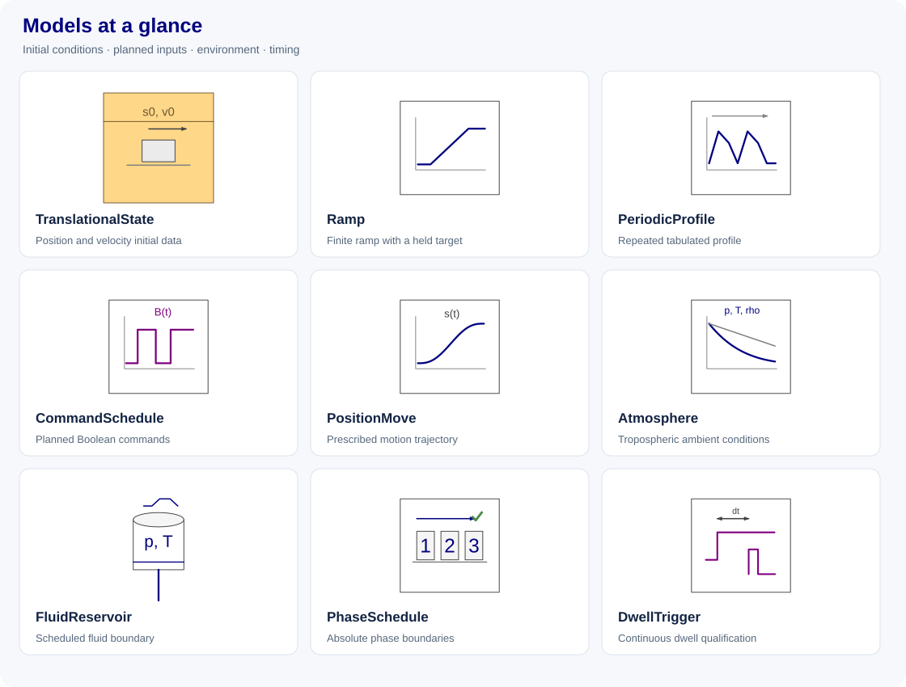

# ScenarioLibrary v1.0.0 — 使用手册

[English](UserGuide.md) · 简体中文

## 目录

- [1. 库的用途与包结构](#1-库的用途与包结构)
- [2. 加载库并查看首个场景](#2-加载库并查看首个场景)
- [3. 绑定初始状态记录](#3-绑定初始状态记录)
- [4. 生成并重新启动计划曲线](#4-生成并重新启动计划曲线)
- [5. 配置运行与环境条件](#5-配置运行与环境条件)
- [6. 组合阶段与条件窗口](#6-组合阶段与条件窗口)
- [7. 选择时钟、事件与状态逻辑](#7-选择时钟事件与状态逻辑)
- [8. 对照场景输入与模型响应](#8-对照场景输入与模型响应)
- [9. 完整模型与类参考](#9-完整模型与类参考)
- [10. 自带示例](#10-自带示例)
- [11. 排错与建模边界](#11-排错与建模边界)
- [12. 文档与延伸阅读](#12-文档与延伸阅读)

## 1. 库的用途与包结构

ScenarioLibrary 为 Modelica 仿真定义确定性的初始条件、计划输入、环境假设及时间逻辑。库中提供 **57 个场景元件与初始状态记录**，配有 **8 个完整示例**。源码共含 **88 个 Modelica 文件**，包括包、函数、类型和工具内指南。唯一库依赖为 **Modelica Standard Library 4.0.0**。

每类场景元素都有明确作用：记录为参数绑定提供数据，信号模块输出计划值或由条件决定的值，物理边界模型则对网络施加约束关系。应按照接口形式，将所选元素连接或绑定到接收模型。

| 包 | 组件或记录数量 | 内容 |
| --- | --- | --- |
| [`Initialization`](../Initialization/package.mo) | 6 | 机械、电气、热、流体和信号量的初始状态记录。 |
| [`Profiles`](../Profiles/package.mo) | 11 | 标量曲线、有限重复曲线及启动—保持—关闭序列。 |
| [`Environment`](../Environment/package.mo) | 14 | 环境信号、重力假设及流体物理边界。 |
| [`Operating`](../Operating/package.mo) | 14 | 负载、命令与模式计划，以及规定运动和运行点。 |
| [`Timing`](../Timing/package.mo) | 12 | 阶段计划、时钟、窗口、持续条件判定及生命周期状态。 |

`Utilities` 提供表格函数、枚举类型和示例使用的阶段负载视图。`Examples` 展示完整连接与初始化绑定，`UsersGuide` 提供建模工具内的简要指南。



预览使用模型现有的本地 Modelica `Icon` 图形，省略实例名与参数标签。模型原有图标、图形布局及连接器位置保持不变。

## 2. 加载库并查看首个场景

1. 解压压缩包，保留完整的 `ScenarioLibrary` 目录。
2. 在建模环境中加载 Modelica 4.0.0，再打开 `ScenarioLibrary/package.mo`。
3. 打开 `ScenarioLibrary.Examples.MultiphaseMission`，查看其 Diagram 图。
4. 使用自带实验设置：0–10 s、输出间隔 0.01 s、容差 `1e-6`。
5. 绘制 `schedule.phaseIndex`、`schedule.phaseId`、`schedule.localTime`、`demand` 和 `finished`。

边界 `{0,1,3,7,10}` 将过程划分为四个左闭右开的阶段。负载依次保持为零、线性上升、保持为一，再线性下降。下表由示例方程推导，可用于对照实际仿真输出。

| 仿真时刻 | 阶段序号 | 阶段内时间 | 计划需求 | Finished |
| --- | --- | --- | --- | --- |
| 0.5 s | 1 | 0.5 s | 0 | false |
| 2 s | 2 | 1 s | 0.5 | false |
| 4 s | 3 | 1 s | 1 | false |
| 8.5 s | 4 | 1.5 s | 0.5 | false |
| 10 s | 0 | 0 s | 0 | true |

`finished` 表示计划已经到达最后一个边界。物理任务是否完成，需要根据接收模型的响应另行定义判据；仅有计划负载并不能给出这个判据。

使用 OpenModelica 时，在包含 `ScenarioLibrary` 文件夹的上级目录中执行：

```modelica
loadModel(Modelica, {"4.0.0"});
loadFile("ScenarioLibrary/package.mo");
checkModel(ScenarioLibrary.Examples.MultiphaseMission);
simulate(ScenarioLibrary.Examples.MultiphaseMission,
  startTime=0, stopTime=10, numberOfIntervals=1000,
  tolerance=1e-6);
getErrorString();
```

## 3. 绑定初始状态记录

六个 `Initialization` 记录用于保存初值与初始化选项。物理状态记录提供独立的 `fixed` 标志，`SignalState` 则提供 `initType` 选项。仅声明记录不会初始化元件，需要将各字段绑定到对应的状态修饰参数。下面给出完整示例，可保存为 `FirstInitialState.mo`。

```modelica
within;
model FirstInitialState "Bind an initial state to a spring-supported mass"
  parameter ScenarioLibrary.Initialization.TranslationalState initialState(
    s_start=0.1,
    v_start=0,
    fixedS=true,
    fixedV=true);
  Modelica.Mechanics.Translational.Components.Fixed reference;
  Modelica.Mechanics.Translational.Components.Spring spring(c=10);
  Modelica.Mechanics.Translational.Components.Mass body(
    m=1,
    s(start=initialState.s_start, fixed=initialState.fixedS),
    v(start=initialState.v_start, fixed=initialState.fixedV));
equation
  connect(reference.flange, spring.flange_a);
  connect(spring.flange_b, body.flange_a);
  annotation(experiment(StartTime=0, StopTime=5,
    Interval=0.01, Tolerance=1e-6));
end FirstInitialState;
```

质量块从 `body.s=0.1 m`、`body.v=0 m/s` 开始运动。绘制这两个状态及弹簧力。记录始终只是配置数据，不会在仿真过程中重新设置质量块状态。

对于状态变量，`start` 提供初值或初始猜测，`fixed=true` 则要求初始化时采用该值。应选择与物理方程一致的独立初始状态；将每个可见变量都设置为固定值，可能使网络过约束。记录提供 fixed 标志时，应像数值字段一样将其显式绑定。

| 记录 | 典型绑定方式 |
| --- | --- |
| `TranslationalState` | 平动物体的位置与速度初值。 |
| `RotationalState` | 转动惯量的转角与角速度初值。 |
| `ElectricalState` | 对应电气元件中的电容电压与电感电流初值。 |
| `ThermalState` | 热容元件的温度初值。 |
| `FluidState` | 所选流体模型中相互一致的压力、温度或组分初值。 |
| `SignalState` | 接收模块所支持的信号或控制器状态初值。 |

记录不会为流体元件选择介质、状态变量或初始化策略。只应绑定该元件实际需要的热力学量，并保持这些量相互一致。

## 4. 生成并重新启动计划曲线

基础模块 `Step`、`Ramp`、`Sine`、`Pulse`、`PiecewiseConstant`、`PiecewiseLinear` 和 `PeriodicProfile` 支持可选的 `enable` 输入。`useEnableInput=false` 时，时间参数采用绝对仿真时间；启用该输入后，每个上升沿都会建立新的局部时间原点。禁用时立即返回 `baseline`，而不是暂停曲线以待随后继续。

将下面的完整模型保存为 `FirstEnabledProfile.mo`：

```modelica
within;
model FirstEnabledProfile "Restart a planned ramp on each enable edge"
  Modelica.Blocks.Sources.BooleanExpression request(
    y=(time >= 1 and time < 2.5) or
      (time >= 3 and time < 5));
  ScenarioLibrary.Profiles.Ramp profile(
    useEnableInput=true,
    baseline=0,
    height=1,
    startTime=0,
    duration=1);
  Modelica.Blocks.Continuous.FirstOrder response(
    T=0.25,
    y_start=0,
    initType=Modelica.Blocks.Types.Init.InitialState);
equation
  connect(request.y, profile.enable);
  connect(profile.y, response.u);
  annotation(experiment(StartTime=0, StopTime=6,
    Interval=0.01, Tolerance=1e-6));
end FirstEnabledProfile;
```

绘制 `request.y`、`profile.y` 和 `response.y`。第一段斜坡从 1 s 开始，第二段从 3 s 开始，每段均用一秒到达目标值。曲线重新启动时，接收端的一阶模块保留自身的动态状态。

| 仿真时刻 | 曲线预期输出 |
| --- | --- |
| 1.5 s | 0.5 |
| 2.25 s | 1 |
| 2.75 s | 0 |
| 3.5 s | 0.5 |
| 5.25 s | 0 |

应查看所选曲线的端点规则。在启用状态下，`PiecewiseLinear` 在第一个节点前保持首值，而 `PiecewiseConstant` 在该区间使用 `baseline`。`PeriodicProfile` 可以在周期内未被表格覆盖的区间保持端点值；`PeriodicLoadCycle` 则要求表格覆盖整个周期。重复启动循环在各活动序列之间包含空闲时间。

通用标量曲线不会自动确定应用中的物理单位，应赋予数值与接收连接器一致的含义和尺度。配置表格时，应同时设置声明的尺寸、有序节点及对应数值。

## 5. 配置运行与环境条件

当专用元件的输出与模型所需物理量一致时，可优先选择该元件。运行计划包括实数负载、布尔命令、整数或枚举模式、运动指令、阀开度、温度轨迹和需求映射。

| 需求 | 可选起点 | 配置要点 |
| --- | --- | --- |
| 负载、功率与扫频请求 | `LoadDemand`、`PowerDemand`、`ScheduledLoadEnvelope` | 为 `LoadDemand` 配置时间表与插值方式；为 `PowerDemand` 配置 basePower、额定值及 [0,1] 范围内的比例输入；为 `ScheduledLoadEnvelope` 配置扫频频率和包络时间。`LoadDemand.unitText` 是元数据；上下限用于校验数值，不会自动截断输出。 |
| 命令与模式 | `CommandSchedule`、`ModeSchedule`、`MultiModeSchedule` | 使用实际声明的布尔、整数或枚举输出，并查看启动前及端点规则。 |
| 规定运动 | `PositionMove`、`SpeedSweep` | 将计划位置或速度接入合适的指令输入，并另外观察接收端的实际运动。 |
| 流量、阀门和转矩请求 | `ReversibleFlowDemand`、`ValveOpeningProfile`、`TorqueSpeedMap` | 保持文档规定的正负号与幅值约定。 |
| 环境信号 | `Temperature`、`Pressure`、`Wind`、`FluidBoundary` | 将输出接入由信号驱动的合适边界或其他接收端输入。 |
| 流体物理边界 | `FluidReservoir` | 选择兼容介质并连接流体端口。该模型是按计划变化的理想边界，没有有限储存量。 |

各环境模型采用各自的假设：

| 元件 | 假设或约定 |
| --- | --- |
| `Atmosphere` | 干空气对流层关系，适用高度限制为 0–11000 m。 |
| `AmbientPressureProfile` | −500–6000 m 范围内的等温指数关系，与 `Atmosphere` 不同。 |
| `Inclination` | 切向以上坡为正，正角度对应 `alongSlope=-g*sin(alpha)`。 |
| `GravitySetting` | 坡度以下坡为正，施加力为 `carriedMass*gravity*sin(grade)`。 |
| `PositionGradeProfile` | 按位置插值坡度，超出表格范围时保持端点坡度。 |
| `AmbientTemperatureCycle`、`WindProfile` | 峰值时刻与相位原点确定波形相位，不是激活区间。 |
| `ScheduledIrradiance` | `illuminated` 标记计划中的光照区间，辐照度仍为零时也可能为 true。 |

配置时应明确区分物理边界与信号描述。只有将压力信号连接到实际使用它的边界模型，才能对流体端口施加压力约束。同样，运动指令并不等于物体的实际运动测量值。

## 6. 组合阶段与条件窗口

`PhaseSchedule` 使用严格递增的绝对时间边界。`phaseIndex` 表示该阶段在计划中的顺序，`phaseId` 是可配置的标识。每个阶段包含起点而不包含终点。在首个阶段前及完成后，阶段序号和阶段内时间均为零；完成时，标识也返回零。

下面的示例只在第二阶段启用斜坡：

```modelica
within;
model FirstPhaseWindow "Enable a planned load during one phase"
  ScenarioLibrary.Timing.PhaseSchedule schedule(
    n=3,
    boundaries={0,2,5,8},
    phaseIds={10,20,30});
  ScenarioLibrary.Timing.PhaseWindow window(targetPhase=2);
  ScenarioLibrary.Profiles.Ramp plannedLoad(
    useEnableInput=true,
    baseline=0,
    height=1,
    startTime=0,
    duration=1);
equation
  connect(schedule.phaseIndex, window.phaseIndex);
  connect(window.active, plannedLoad.enable);
  annotation(experiment(StartTime=0, StopTime=8,
    Interval=0.01, Tolerance=1e-6));
end FirstPhaseWindow;
```

绘制 `schedule.phaseIndex`、`schedule.phaseId`、`window.active` 和 `plannedLoad.y`。第二阶段的序号为 2、标识为 20，而 `PhaseWindow.targetPhase` 选择的是序号，因此应设置为 2。负载从 2 s 开始上升，在 3 s 到达一，保持至 5 s，窗口关闭后返回基准值。

绝对时间区间使用 `TimeWindow`，阶段序号条件使用 `PhaseWindow`。`PhaseScheduler` 和 `BranchingPhaseSchedule` 提供其他转换规则，替换前应查看其输入与边界语义。示例视图 `Utilities.Views.PhaseLoad` 的上升时长固定为 2 s，下降时长固定为 3 s；使用该视图时应相应配置外围阶段计划。

## 7. 选择时钟、事件与状态逻辑

时钟与状态元件具有不同用途，应明确选择所需的复位、暂停与完成行为。

| 元件 | 需要了解的行为 |
| --- | --- |
| `LocalClock` | 使用参考时刻或条件启动输入。接受新的触发时可重置时间原点；`start` 下降不会暂停计时。`stopTime` 是绝对仿真时间的上限。 |
| `MissionClock` | 累计启用状态下的时间，支持暂停与继续。没有复位输入，报告的已用时间受 duration 限制。 |
| `EventSequence` | 报告已到达的计划事件及其标识；判断推进过程时应查看事件计数。 |
| `DwellTrigger` | 条件连续为 true 达到 `dwellTime` 后判定成立。`fired` 保持为 true，直到条件解除；每个满足要求的连续区间只增加一次计数。 |
| `AccessWindowSchedule` | 描述计划访问窗口。`hasNext` 指严格晚于当前时刻的下次开始，因此最后一个窗口仍激活时，它也可能为 false。 |
| `MissionLifecycle` | 按明确的事件优先级处理生命周期请求，在接受新一轮运行时重置活动时间累计。 |
| `TaskStatus` | 按声明的优先级及有效条件处理输入的开始、完成与中止请求。 |

在 `RepeatedEventsAndDwell` 中，短条件区间 `[1,1.2)` s 不满足 0.3 s 的持续时间要求，而 `[2,2.7)` s 在 2.3 s 时满足条件。同一条件还会分别在 1 s 和 2 s 重新启动局部时钟，但下降沿不会停止该时钟。可同时绘制条件、持续判定标志、计数和已用时间，查看这些区别。

对状态模块，应连接应用中定义开始、完成、中止与恢复的实际条件。模块按自身状态逻辑解释这些输入，不会从无关的本体模型中自动推断条件。同时到达的请求以及初始化时已经为 true 的请求，需要按文档说明的优先规则理解。

## 8. 对照场景输入与模型响应

记录每次运行采用的初始状态绑定、曲线参数、环境假设与时间规则。比较不同模型参数时，可共用同一个场景输入，或采用相同的显式设置，并保持初始条件及求解器设置一致。

同时观察连接两侧：场景给出的请求值，以及接收模型产生的状态或测量量。`ReusableScenario` 使用一条斜坡和两个一阶响应展示了这种对照。规定计划中的到达、完成和重新启动标志，只报告自身的数学条件，并不代表系统已经实现相应目标。

在不连续点处，应比较计划节点之前和节点处的数值。线性段、立即保持的阶跃以及局部时间重新启动具有不同含义。若要求一个满足条件的连续区间只计数一次，应同时读取计数器和布尔标志。

环境有效范围与符号约定也是模型假设的一部分。应选择适合应用的表格值、有限序列长度和边界幅值。下方参考表逐个列出所有源码文件的配置要点与限制。

## 9. 完整模型与类参考

下表按包列出全部 88 个源码文件，点击名称可打开相应 Modelica 定义。选择记录、信号模块、边界或时序组件时，请结合参数对话框阅读配置方法与使用边界。

### 9.1. ScenarioLibrary

| 类 | 用途 | 配置与使用边界 |
| --- | --- | --- |
| [`ScenarioLibrary`](../package.mo) | 确定性的初始条件、计划输入与时序。 | 加载 Modelica 4.0.0 和 package.mo，从 Examples.MultiphaseMission 入门。 |

### 9.2. Initialization

| 类 | 用途 | 配置与使用边界 |
| --- | --- | --- |
| [`Initialization`](../Initialization/package.mo) | 用于显式初始状态绑定的记录。 | 选择记录，并将其字段显式绑定到宿主模型。 |
| [`ElectricalState`](../Initialization/ElectricalState.mo) | 电压与电流初始状态设置。 | 将 v_start/fixedV 与 i_start/fixedI 分别绑定到对应的宿主状态修饰参数。 记录仅保存设置；未显式绑定时不会初始化或重置元件。 |
| [`FluidState`](../Initialization/FluidState.mo) | 流体压力、温度及组分初始状态设置。 | 将 p_start、T_start、X_start 及其标志绑定到所选宿主的初始化参数。 记录仅保存设置；未显式绑定时不会初始化或重置元件。 该记录不校验组分有效性或宿主初始化一致性。 |
| [`RotationalState`](../Initialization/RotationalState.mo) | 独立的初始转角与角速度设置。 | 将两组 start/fixed 值绑定到转动宿主状态。 记录仅保存设置；未显式绑定时不会初始化或重置元件。 |
| [`SignalState`](../Initialization/SignalState.mo) | 信号初值与初始化选项。 | 将 x_start 与 initType 映射到接收模块实际使用的初始化参数。 记录仅保存设置；未显式绑定时不会初始化或重置元件。 |
| [`ThermalState`](../Initialization/ThermalState.mo) | 初始温度设置与固定标志。 | 将 T_start 和 fixedT 绑定到热状态的 start 与 fixed 修饰参数。 记录仅保存设置；未显式绑定时不会初始化或重置元件。 |
| [`TranslationalState`](../Initialization/TranslationalState.mo) | 独立的初始位置与速度设置。 | 将两组 start/fixed 值绑定到平动宿主状态。 记录仅保存设置；未显式绑定时不会初始化或重置元件。 |

### 9.3. Profiles

| 类 | 用途 | 配置与使用边界 |
| --- | --- | --- |
| [`Profiles`](../Profiles/package.mo) | 标量曲线与有限运行周期。 | 选择所需曲线，并检查时间基准、端点取值及重复规则。 |
| [`PeriodicLoadCycle`](../Profiles/PeriodicLoadCycle.mo) | 有限次数重复的完整负载曲线。 | 提供覆盖完整周期的 points[n,2]，设置 cycles 和 standby，并查看 y 与 cycle。 表格末端从左侧趋近；到达周期边界时，局部时间立即回到零。 |
| [`PeriodicProfile`](../Profiles/PeriodicProfile.mo) | 有限次数重复的线性插值曲线。 | 设置表格、period、nCycles 和 endValue；每个周期均从局部时间零重新开始。 周期首尾值不相同时，重复周期边界可能发生跳变。 |
| [`PiecewiseConstant`](../Profiles/PiecewiseConstant.mo) | 具有可配置起始值的右连续分段常量表。 | 提供长度均为 n 的 times 和 values 数组；到达节点时刻即选用该节点的新值。 |
| [`PiecewiseLinear`](../Profiles/PiecewiseLinear.mo) | 带端点保持的时间线性插值。 | 提供相互匹配的 times 和 values 数组；baseline 是禁用输出，不是启用后首节点之前的值。 启用后首节点之前输出 values[1]，这一点与 PiecewiseConstant 不同。 |
| [`Pulse`](../Profiles/Pulse.mo) | 有限次左闭右开矩形脉冲序列。 | 设置 width、period 和 nCycles，满足 width<=period；脉冲间及序列结束后，y 返回 baseline。 |
| [`Ramp`](../Profiles/Ramp.mo) | 完成后保持终值的有限线性斜坡。 | 设置 startTime、正 duration 和有符号 height，根据所选时间基准查看 y。 |
| [`RepeatingStartupCycle`](../Profiles/RepeatingStartupCycle.mo) | 重复执行启动、保持、停机与休息序列。 | 设置 riseTime、holdTime、fallTime、idleTime 和 cycles，同时观察 y、cycle 与 completed。 cycle 非零也包含休息阶段，并不表示需求一定高于待机值。 |
| [`ScheduledLoadEnvelope`](../Profiles/ScheduledLoadEnvelope.mo) | 具有有限幅值包络的线性扫频负载。 | 设置频率范围、duration、edgeTime、meanLoad 和 amplitude，按接收信号的单位使用 load。 幅值包络为分段线性形式，并不保证所有边界处的输出导数连续。 |
| [`Sine`](../Profiles/Sine.mo) | 在左闭右开时间窗内输出正弦曲线。 | 设置 amplitude、frequency、phase 及时间窗，读取 y；空时间窗始终输出 baseline。 如果正弦项在窗口边界不为零，输出会在边界发生跳变。 |
| [`StartupHoldShutdown`](../Profiles/StartupHoldShutdown.mo) | 线性启动、保持与停机需求曲线。 | 设置 standby、rated 及三个阶段时长，将 y 连接到所需需求输入。 |
| [`Step`](../Profiles/Step.mo) | 具有可选局部时间原点的计划阶跃。 | 设置 baseline、height 和 startTime；仅在 useEnableInput=true 时连接 enable，并读取 y。 |

### 9.4. Environment

| 类 | 用途 | 配置与使用边界 |
| --- | --- | --- |
| [`Environment`](../Environment/package.mo) | 环境信号与物理边界。 | 选择所需环境量或物理边界。 |
| [`AmbientPressureProfile`](../Environment/AmbientPressureProfile.mo) | 由海拔信号计算等温大气压力。 | 连接 altitude，设置 seaLevelPressure 与 scaleHeight，读取 pressure。 海拔限制为 -500–6000 m；该关系与采用温度递减率的 Atmosphere 模型不同。 |
| [`AmbientTemperatureCycle`](../Environment/AmbientTemperatureCycle.mo) | 具有规定峰值时刻的周期环境温度。 | 设置温度上下限、period 及任一峰值时刻 peakTime，将 temperature 连接到所需边界或信号输入。 peakTime 确定相位，不是激活时刻。 |
| [`Atmosphere`](../Environment/Atmosphere.mo) | 干空气对流层温度、压力及密度。 | 连接以米计的 height，读取 T、p 和 rho，作为干空气环境假设。 明确校验的适用高度为 0–11000 m；不包含湿度和天气变化。 |
| [`FluidBoundary`](../Environment/FluidBoundary.mo) | 恒定压力、温度与组分信号。 | 设置 pressure、temperature、nX 与 fractions，将 p、T、X 接入兼容的边界输入。 该模块不含流体连接器或储库状态。 |
| [`FluidReservoir`](../Environment/FluidReservoir.mo) | 按任务剖面变化的流体压力与温度边界。 | 选择 Medium 并连接 port，设置待机与运行目标，以及 startTime、startupTime、operatingTime 和 shutdownTime。 压力与温度共用同一归一化剖面；储库没有有限储存容量。 |
| [`Gravity`](../Environment/Gravity.mo) | 给定参考坐标系中的恒定重力向量。 | 按接收端坐标系设置 g，并将 gVector 接入对应的信号接口。 参考坐标系约定由应用模型确定。 |
| [`GravitySetting`](../Environment/GravitySetting.mo) | 给定坡度下的切向重力载荷。 | 连接 grade 与 flange，设置 carriedMass 和 gravity，同时查看 force 与物体运动。 正坡度产生正向施加力；其符号约定与 Inclination 不同。 |
| [`Inclination`](../Environment/Inclination.mo) | 沿上坡正方向分解的重力加速度。 | 设置 alpha 和 g，将 alongSlope 与 normal 作为带符号的加速度分量使用。 切向采用上坡为正，与 GravitySetting 的下坡为正约定不同。 |
| [`PositionGradeProfile`](../Environment/PositionGradeProfile.mo) | 按位置对路径坡度进行线性插值。 | 填写两列 stations 表，连接 position，并按所选坡度正方向约定使用 grade。 位置超出范围时保持端点坡度；表本身不规定上坡或下坡为正。 |
| [`Pressure`](../Environment/Pressure.mo) | 分段线性绝对压力时序。 | 设置 n、times 及正值 values，连接以帕为单位的 y。 时刻表采用绝对仿真时间，并保持端点值。 |
| [`ScheduledIrradiance`](../Environment/ScheduledIrradiance.mo) | 具有线性辐照度过渡的重复明暗时序。 | 设置 startTime、period、lightTime、transitionTime 与 fullIrradiance；将 illuminated 用作时序标志，将 irradiance 用作物理输入。 illuminated 不判断辐照度是否严格为正，fullIrradiance=0 时也遵循时序。 |
| [`Temperature`](../Environment/Temperature.mo) | 分段线性绝对温度时序。 | 设置 n、times 及正值 values，再将 y 接入温度输入。 时刻表采用绝对仿真时间，并保持端点值。 |
| [`Wind`](../Environment/Wind.mo) | 三分量分段线性风速时序。 | 设置 times 和 values 的三列速度分量，并在同一坐标系下连接 vx、vy、vz。 带符号的向量分量不同于 WindProfile 提供的非负标量风速。 |
| [`WindProfile`](../Environment/WindProfile.mo) | 带正弦调制的非负标量风速。 | 设置 meanWind、modulation、period 和 phaseOrigin，将 speed 接入标量风速输入。 phaseOrigin 设置相位而非激活时刻；参数有效时 speed 保持非负。 |

### 9.5. Operating

| 类 | 用途 | 配置与使用边界 |
| --- | --- | --- |
| [`Operating`](../Operating/package.mo) | 运行指令、模式与需求时间表。 | 连接运行指令前，先选择所需信号类型、单位和时间规则。 |
| [`CommandSchedule`](../Operating/CommandSchedule.mo) | 右连续布尔指令时间表。 | 提供匹配的 times 与布尔 values 数组，并设置表格之前的 baseline；将 y 接到指令输入。 |
| [`DutyCycle`](../Operating/DutyCycle.mo) | 有限次数运行与休息时间窗。 | 设置 startTime、period、duty 和 cycles，分别读取 running 与 completed。 |
| [`HystereticStandby`](../Operating/HystereticStandby.mo) | 通过滞环选择额定运行或待机工况。 | 连接 plannedDemand，使 enterStandby 小于 enterRun，并用 initialRun 指定初值位于带内时的状态。 |
| [`LoadDemand`](../Operating/LoadDemand.mo) | 支持插值选择及范围校验的负载表。 | 设置匹配的 times 与 values，选择 method 并声明 lower/upper；按预期信号单位解读 y。 边界用于校验数值；unitText 不进行单位换算，也不会改变 y 的单位注解。 |
| [`ModeSchedule`](../Operating/ModeSchedule.mo) | 右连续整数模式时间表。 | 设置 times、整数 values 和 baseline，按接收模型定义的模式编码使用 y。 |
| [`MultiModeSchedule`](../Operating/MultiModeSchedule.mo) | 按阶段持续时间给出模式与负载比例。 | 提供长度均为 n 的 durations、modes 和 loadFraction，观察 phase、mode、demand 与 completed。 |
| [`OperatingPoint`](../Operating/OperatingPoint.mo) | 带通道元数据的恒定工况向量。 | 将 values、names、units 及各通道边界设置为长度 n，并连接对应的 y 元素。 |
| [`PositionMove`](../Operating/PositionMove.mo) | 端点速度与加速度为零的五次位置指令。 | 设置两个位置、startTime 和 duration，连接 position 或 velocity；arrived 表示计划到达时刻。 |
| [`PowerDemand`](../Operating/PowerDemand.mo) | 基础功率与独立任务需求的加权总和。 | 连接全部 fraction 输入，设置 basePower 与 ratings，将 power 用作负载指令。 |
| [`ReversibleFlowDemand`](../Operating/ReversibleFlowDemand.mo) | 围绕均值的有限正弦质量流量指令。 | 设置 meanFlow、amplitude、period 和 cycles，将 requestedFlow 连接到兼容的流量指令输入。 |
| [`SpeedSweep`](../Operating/SpeedSweep.mo) | 端点保持的对数角速度扫描。 | 设置正的起止转速及 duration，将 speed 和 acceleration 用作相互一致的运动指令。 |
| [`ThermalSoakSchedule`](../Operating/ThermalSoakSchedule.mo) | 带浸泡与再启动标记的指数温度参考。 | 设置温度、shutdownAt、coolingTime 和 soakDuration，分别读取 temperature 与时间标记。 |
| [`TorqueSpeedMap`](../Operating/TorqueSpeedMap.mo) | 由转速绝对值查表得到的反向负载转矩。 | 按 rad/s 和 N.m 提供 points[n,2]，连接有符号 speed，再将 torque 送入适当的转矩源。 |
| [`ValveOpeningProfile`](../Operating/ValveOpeningProfile.mo) | 两个开度设置之间的三次过渡指令。 | 设置两个开度及过渡时长，满足 closeAt>=openAt+openingTime，并将 opening 连接到阀指令。 |

### 9.6. Timing

| 类 | 用途 | 配置与使用边界 |
| --- | --- | --- |
| [`Timing`](../Timing/package.mo) | 时钟、阶段、时间窗与任务声明状态。 | 先选定时间语义与接口，再组合计划和条件。 |
| [`AccessWindowSchedule`](../Timing/AccessWindowSchedule.mo) | 带提前准备标记的有序接入时间窗。 | 设置 starts、ends 和 leadTime；通过 activeIndex 判断接入窗口，通过 preparing 判断提前准备。 最后一个窗口仍激活时 hasNext 也可能为 false；它表示后续起点，不表示当前是否接入。 |
| [`BranchingPhaseSchedule`](../Timing/BranchingPhaseSchedule.mo) | 在指定阶段边界采样一次跳转决定的阶段计划。 | 连接 jumpRequested，配置 durations、branchFrom 与 branchTo，观察 phase、elapsed、jumped 和 completed。 只在所选边界读取跳转决定，之后改变请求不会更改既有决定。 |
| [`DwellTrigger`](../Timing/DwellTrigger.mo) | 对连续满足条件的驻留过程进行判定与计数。 | 连接 condition 并设置 dwellTime，通过 count 识别多次满足驻留要求的过程。 fired 是持续的合格标志，并非仅持续一个事件步的脉冲。 |
| [`EventSequence`](../Timing/EventSequence.mo) | 统计预定事件并保持最新事件标识。 | 设置 times 和 eventIds，通过 eventCount 的变化识别新的预定事件。 输出为累计次数与保持的标识，不是事件脉冲。 |
| [`LocalClock`](../Timing/LocalClock.mo) | 支持可选重启输入的局部时钟。 | 固定起点使用 referenceTime；触发计时则启用并连接 start，设置 retrigger 及绝对 stopTime。 在 stopTime 或之后触发可能使 elapsed 重置为零；start 下降不会暂停时钟。 |
| [`MissionClock`](../Timing/MissionClock.mo) | 具有有界显示时长的可暂停任务时钟。 | 连接 enable，设置 startTime、duration 和 speed，观察 elapsed、running 与 completed。 输出时间有限幅，但内部累计状态不受该限幅约束；时钟不支持重启。 |
| [`MissionLifecycle`](../Timing/MissionLifecycle.mo) | 支持暂停、恢复准备及重启的事件驱动任务状态。 | 连接六个事件输入并观察 state、running、runCount 和 elapsedActive。中止后，应先请求 recover，再启动新一轮任务。 事件优先级依次为 abort、complete、pause、recover、resume、start；初始化仅处理 start/abort 条件。 |
| [`PhaseSchedule`](../Timing/PhaseSchedule.mo) | 具有明确完成状态的绝对时间阶段边界。 | 设置 boundaries 和 phaseIds；顺序阶段判定使用 phaseIndex，自定义阶段标识使用 phaseId。 最终边界表示计划完成，不会继续保持最后一个阶段索引。 |
| [`PhaseScheduler`](../Timing/PhaseScheduler.mo) | 由正持续时间定义的连续阶段。 | 设置 startTime 和 durations，将 phase 与 elapsed 或 remaining 配合用于选择计划操作。 |
| [`PhaseWindow`](../Timing/PhaseWindow.mo) | 对单个阶段索引进行布尔判定。 | 连接顺序阶段索引，将 targetPhase 设为所需阶段编号。 应使用顺序索引而非任意 phaseId，除非自定义标识恰好与索引一致。 |
| [`TaskStatus`](../Timing/TaskStatus.mo) | 具有中止及完成优先级的任务声明状态。 | 连接 start、complete 和 abort，通过 status 读取声明状态，通过 running 判断运行状态。 每次识别到事件都会读取当前输入电平；abort 优先于完成，完成优先于 start。 |
| [`TimeWindow`](../Timing/TimeWindow.mo) | 绝对时间左闭右开窗口。 | 设置 startTime 与 endTime，通过 active 选择所需观测或运行区间。 |

### 9.7. Utilities

| 类 | 用途 | 配置与使用边界 |
| --- | --- | --- |
| [`Utilities`](../Utilities/package.mo) | 共享场景函数、类型与视图。 | 按需查看 Functions、Types 与 Views 中的共享定义。 |

### 9.8. Utilities.Functions

| 类 | 用途 | 配置与使用边界 |
| --- | --- | --- |
| [`Functions`](../Utilities/Functions/package.mo) | 有序表查找与插值。 | 保持型查表使用 TableIndex，线性数值插值使用 Interpolate。 |
| [`Interpolate`](../Utilities/Functions/Interpolate.mo) | 具有端点保持的线性插值。 | 调用 Interpolate(t, times, values)，提供非空且严格递增的坐标表，以及等长的数值数组。 排序由调用方保证，函数内部仅断言数组非空。 |
| [`TableIndex`](../Utilities/Functions/TableIndex.mo) | 有序坐标表的右连续索引。 | 调用 TableIndex(t, times) 查找已到达的最后一项；访问其他数组前，应先处理索引为零的情况。 |

### 9.9. Utilities.Types

| 类 | 用途 | 配置与使用边界 |
| --- | --- | --- |
| [`Types`](../Utilities/Types/package.mo) | 场景状态与插值枚举。 | 使用接收元件所声明的枚举类型。 |
| [`MissionState`](../Utilities/Types/MissionState.mo) | 外部声明的任务生命周期状态。 | 使用 MissionState 表示生命周期状态，具体转移规则见生命周期模块。 |
| [`OperatingMode`](../Utilities/Types/OperatingMode.mo) | 具名的计划运行工况。 | 在声明运行工况枚举的位置使用 OperatingMode 值。 |
| [`ProfileInterpolation`](../Utilities/Types/ProfileInterpolation.mo) | 曲线插值策略。 | 将接收曲线的插值参数设为 Constant 或 Linear。 |
| [`TaskState`](../Utilities/Types/TaskState.mo) | 外部声明的任务状态。 | 使用 TaskState 表示任务声明状态。 |

### 9.10. Utilities.Views

| 类 | 用途 | 配置与使用边界 |
| --- | --- | --- |
| [`Views`](../Utilities/Views/package.mo) | 计划场景信号的简洁视图。 | 按 PhaseLoad 的阶段与局部时间约定使用该视图。 |
| [`PhaseLoad`](../Utilities/Views/PhaseLoad.mo) | 固定四阶段负载显示关系。 | 连接阶段计划的 phaseIndex 与非负 localTime，通过 demand 读取固定的四阶段负载。 阶段 2 上升与阶段 4 下降的时长固定为 2 s 和 3 s；输入的负 localTime 不会被截断。 |

### 9.11. UsersGuide

| 类 | 用途 | 配置与使用边界 |
| --- | --- | --- |
| [`UsersGuide`](../UsersGuide/package.mo) | 工具内使用指南。 | 从 GettingStarted 入门，再查看接口约定与建模边界。 |
| [`Conventions`](../UsersGuide/Conventions.mo) | 时间参考、记录绑定与信号含义。 | 连接元件前，检查单位、时间参考、边界规则及各状态输出的含义。 |
| [`GettingStarted`](../UsersGuide/GettingStarted.mo) | 加载库并查看首个场景。 | 先运行 MultiphaseMission，再通过 ReusableScenario 区分计划输入与模型响应。 |
| [`Limitations`](../UsersGuide/Limitations.mo) | 初始化与环境建模边界。 | 检查独立初始状态、表格定义、环境适用范围及明确的达成判据。 |
| [`Overview`](../UsersGuide/Overview.mo) | 库的用途与包结构。 | 按模型所需的场景接口选择相应包。 |

### 9.12. Examples

| 类 | 用途 | 配置与使用边界 |
| --- | --- | --- |
| [`Examples`](../Examples/package.mo) | 完整的场景配置示例。 | 按初始化、曲线、环境或时序接口选择示例。 |
| [`ElectricalThermalInitialization`](../Examples/ElectricalThermalInitialization.mo) | 在独立网络中绑定电气与热初始状态。 | 使用自带实验设置运行，观察要点见第 10 节。 |
| [`EnvironmentalConditions`](../Examples/EnvironmentalConditions.mo) | 查看大气条件与环境信号。 | 使用自带实验设置运行，观察要点见第 10 节。 |
| [`LoadAndCommandSchedules`](../Examples/LoadAndCommandSchedules.mo) | 生成实数、布尔与整数运行计划。 | 使用自带实验设置运行，观察要点见第 10 节。 |
| [`MechanicalInitialization`](../Examples/MechanicalInitialization.mo) | 绑定独立的平动与转动初始状态。 | 使用自带实验设置运行，观察要点见第 10 节。 |
| [`MultiphaseMission`](../Examples/MultiphaseMission.mo) | 按四个连续阶段生成计划负载。 | 使用自带实验设置运行，观察要点见第 10 节。 |
| [`PhaseQualifiedWindows`](../Examples/PhaseQualifiedWindows.mo) | 比较阶段门控与绝对时间窗口。 | 使用自带实验设置运行，观察要点见第 10 节。 |
| [`RepeatedEventsAndDwell`](../Examples/RepeatedEventsAndDwell.mo) | 比较计划事件计数、持续条件判定与时钟重启。 | 使用自带实验设置运行，观察要点见第 10 节。 |
| [`ReusableScenario`](../Examples/ReusableScenario.mo) | 将同一计划斜坡输入施加到两个独立动态模型。 | 使用自带实验设置运行，观察要点见第 10 节。 |

## 10. 自带示例

每个示例均包含激励源、连接及实验设置，输出间隔均为 0.01 s，容差均为 `1e-6`。按应用所需接口选择示例，从表中列出的输出开始观察。

| 示例 | 仿真区间 | 观察要点 |
| --- | --- | --- |
| [`ElectricalThermalInitialization`](../Examples/ElectricalThermalInitialization.mo) | 0–5 s | 在初始化时将 capacitor.v、inductor.i 和 thermal.T 与记录值对照，并观察各自衰减过程。 |
| [`EnvironmentalConditions`](../Examples/EnvironmentalConditions.mo) | 0–5 s | 比较 seaPressure、hillPressure 和 upperPressure，并查看温度、压力、坡度及风速读回输出。 |
| [`LoadAndCommandSchedules`](../Examples/LoadAndCommandSchedules.mo) | 0–6 s | 共同绘制三路输出，比较计划节点之前及节点处的取值。 |
| [`MechanicalInitialization`](../Examples/MechanicalInitialization.mo) | 0–5 s | 修改记录前，查看四个机械状态及其显式 start、fixed 修饰参数。 |
| [`MultiphaseMission`](../Examples/MultiphaseMission.mo) | 0–10 s | 使用自带实验设置运行，对照各边界处的 phaseIndex、localTime、demand 和 finished。 |
| [`PhaseQualifiedWindows`](../Examples/PhaseQualifiedWindows.mo) | 0–8 s | 比较 phaseActive 与 timeActive，再查看停止后保持的 localElapsed 输出。 |
| [`RepeatedEventsAndDwell`](../Examples/RepeatedEventsAndDwell.mo) | 0–6 s | 比较 plannedCount 与 dwellCount，并观察条件第二次上升时的时钟重置。 |
| [`ReusableScenario`](../Examples/ReusableScenario.mo) | 0–6 s | 共同绘制 scenario.y、fastResponse 和 slowResponse，比较时间常数时保持共享输入一致。 |

## 11. 排错与建模边界

| 现象 | 检查内容 |
| --- | --- |
| 记录没有改变初始状态 | 将记录字段显式绑定到接收元件的初值与初始化选项。 |
| 初始化不一致 | 检查独立状态的选择，避免同时施加相互矛盾的固定值。 |
| 曲线返回基准值或重新启动 | 检查 useEnableInput 与 enable 的边沿；禁用的基础曲线会将输出恢复为 baseline。 |
| 表格在首末节点附近表现不符合预期 | 检查节点顺序、维数、插值及所选模块的端点规则。 |
| 阶段窗口始终不打开 | PhaseWindow 使用 phaseIndex；配置的 phaseId 可能与该序号不同。 |
| 启动信号下降后时钟仍继续运行 | LocalClock 会锁存启动，应选择具有所需暂停语义的时钟。 |
| 持续条件判定标志保持为 true | fired 表示仍在持续成立的条件；使用 count 识别满足持续时间要求的区间次数。 |
| 完成标志与实际运动不一致 | 检查标志的定义，需要时提供明确的物理目标达成条件。 |
| 环境力或压力看似不一致 | 检查单位、高度范围、坐标符号、介质，以及所选对象提供的是信号还是物理边界。 |

表格函数具有明确且有限的接口约定。`TableIndex` 对空表返回零，不校验节点顺序。`Interpolate` 要求节点表非空且严格递增，由调用方保证节点与数值一致；公开模块只执行自身声明的检查。

示例展示特定配置。本手册中的解析值来自所提供的方程与参数，应与实际应用所用 Modelica 环境中的结果对照。

## 12. 文档与延伸阅读

- [英文项目说明](../README.md) / [中文项目说明](../README.zh-CN.md)
- [工具内使用指南](../UsersGuide/package.mo)
- [根包定义](../package.mo)
- [Buildings Library User Guide — Getting Started](https://simulationresearch.lbl.gov/modelica/userGuide/gettingStarted.html)
- [Buildings — SimpleHouse 分步教程](https://simulationresearch.lbl.gov/modelica/releases/v11.1.2/help/Buildings_Examples_Tutorial_SimpleHouse.html)
- [Modelica 文档约定](https://doc.modelica.org/Modelica%204.0.0/Resources/helpDymola/Modelica_UsersGuide_Conventions_Documentation.html)
- [许可证：GNU General Public License v3](../LICENSE)
